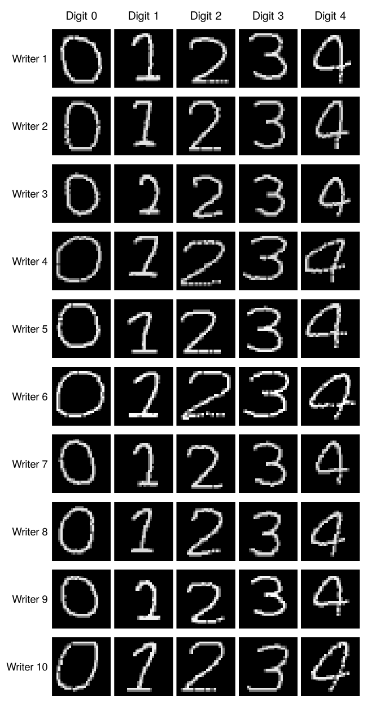
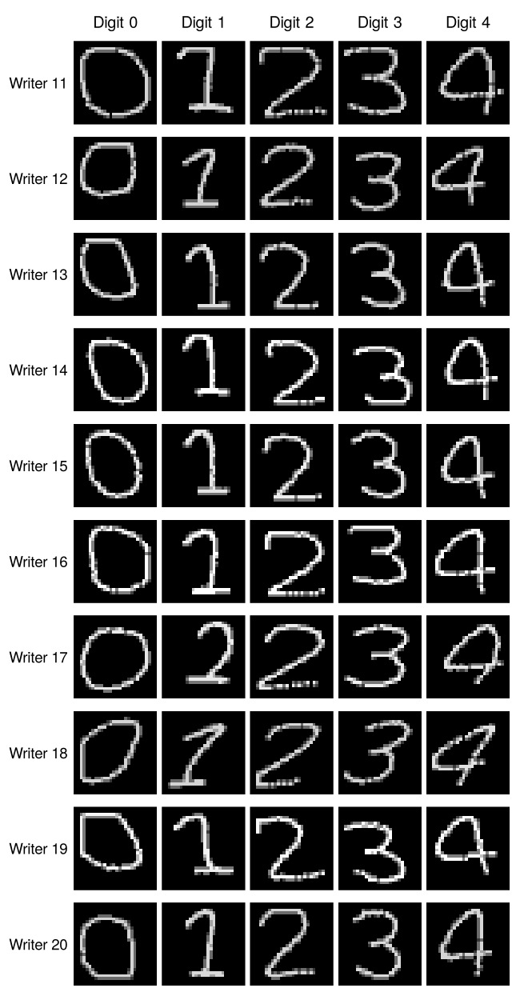
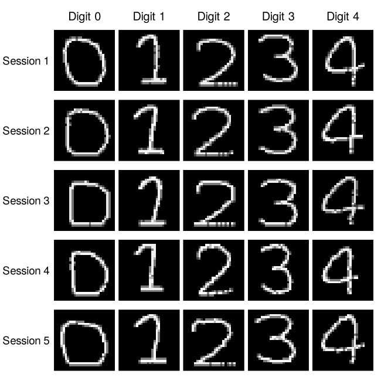
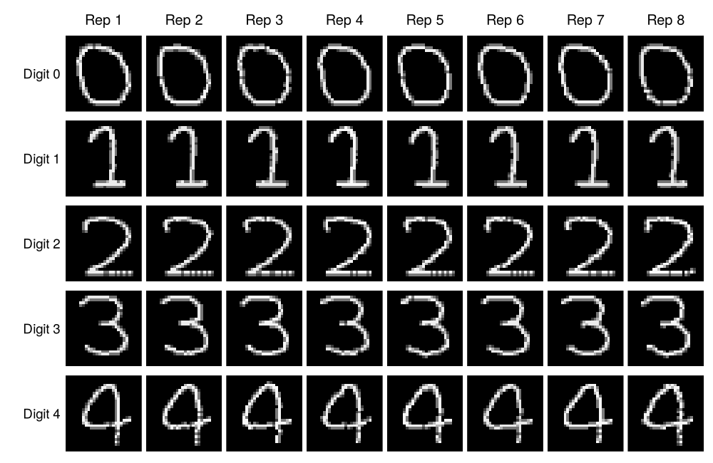

```{r setup, include=FALSE}
library(dplyr)

for (folder in c("images", "results", "models")) dir.create(folder, showWarnings = FALSE)

# Train the models only when asked to, or when saved results are missing
need_training = isTRUE(params$retrain) ||
  !all(file.exists(c("results/cnn_grid.csv", "results/cnn_predictions.csv",
                     "results/siamese_pairs.csv", "results/siamese_design.rds")))

# Formatting helpers for the text
pct = function(p, digits = 1) sprintf(paste0("%.", digits, "f%%"), 100 * p)
pts = function(p) sprintf("%.1f", 100 * p)
fmt_lr = function(lr) format(lr, scientific = FALSE)
and_list = function(x) {
  x = as.character(x)
  if (length(x) <= 1) return(x)
  paste(paste(x[-length(x)], collapse = ", "), "and", x[length(x)])
}
digit_list = function(d) paste0(if (length(d) > 1) "digits " else "digit ", and_list(d))

# Training and validation curves on one panel
plot_curves = function(train, val, ylab, ylim, legend_at = NULL) {
  plot(train, type = "l", lwd = 2, ylim = ylim, xlab = "Epoch", ylab = ylab)
  lines(val, lwd = 2, lty = 2, col = "firebrick")
  if (!is.null(legend_at)) {
    legend(legend_at, c("training", "validation"), lty = 1:2, lwd = 2,
           col = c("black", "firebrick"), bty = "n", cex = 0.8)
  }
}
```

```{r data, include=FALSE}
# Task 1: load the data, check it and draw example images
handwriting = readRDS("data/handwriting.rds")
metadata = handwriting$metadata
images = handwriting$images   # 25000 x 28 x 28 x 1, pixel values 0-255

stopifnot(
  dim(images)[1] == nrow(metadata),
  all(metadata$image_id == seq_len(nrow(metadata))),
  all(with(metadata, table(person_id, session, digit)) == 50),
  !anyNA(images), !anyNA(metadata)
)

find_image = function(writer, session, digit, replicate = 1) {
  which(metadata$person_id == writer & metadata$session == session &
          metadata$digit == digit & metadata$replicate == replicate)
}

# Matrix of image numbers, one row per value of `rows` and one column per value of `cols`
image_index = function(rows, cols, pick) {
  t(sapply(rows, function(r) sapply(cols, function(cl) pick(r, cl))))
}

draw_digit = function(i) {
  pixels = images[i, , , 1]
  image(t(pixels[28:1, ]), col = gray(seq(0, 1, length.out = 256)),
        zlim = c(0, 255), axes = FALSE, asp = 1, useRaster = TRUE)
}

image_grid = function(file, index, row_labels, col_labels, width, height) {
  png(file, width = width, height = height, res = 150)
  par(mfrow = dim(index), mar = rep(0.15, 4), oma = c(0.5, 4.5, 2.2, 0.5))
  for (r in seq_len(nrow(index))) {
    for (cl in seq_len(ncol(index))) {
      draw_digit(index[r, cl])
      if (cl == 1) mtext(row_labels[r], side = 2, line = 0.4, las = 1, cex = 0.75)
      if (r == 1) mtext(col_labels[cl], side = 3, line = 0.4, cex = 0.8)
    }
  }
  dev.off()
}

# One writer's five sessions, replicate 1 of each digit
sessions_figure = function(writer) {
  file = sprintf("images/sessions_writer_%02d.png", writer)
  index = image_index(1:5, 0:4, function(s, d) find_image(writer, s, d))
  image_grid(file, index, paste("Session", 1:5), paste("Digit", 0:4), 650, 650)
  file
}

# All writers and digits from session 1, split into two images of ten writers
index = image_index(1:20, 0:4, function(w, d) find_image(w, 1, d))
for (first in c(1, 11)) {
  writers = first:(first + 9)
  image_grid(sprintf("images/writers_%02d_%02d.png", first, first + 9), index[writers, ],
             paste("Writer", writers), paste("Digit", 0:4), 650, 1250)
}

sessions_figure(1)

index = image_index(0:4, 1:8, function(d, r) find_image(1, 1, d, r))
image_grid("images/within_session.png", index, paste("Digit", 0:4),
           paste("Rep", 1:8), 1000, 650)

# Simple size measures: ink is the mean pixel value, height and width count the
# rows and columns that contain a pixel brighter than 50
pixels = images[, , , 1]
inked = pixels > 50
summ = data.frame(
  metadata,
  ink = apply(pixels, 1, mean),
  height = apply(inked, 1, function(a) sum(rowSums(a) > 0)),
  width = apply(inked, 1, function(a) sum(colSums(a) > 0))
)
```

```{r cnn-train, include=FALSE, eval=need_training}
# Tasks 2 and 5: CNN writer identification and the hyperparameter grid
library(keras3)
use_backend("tensorflow")

epochs = 20
batch_size = 64
x = images / 255
y = metadata$person_id - 1   # Keras needs classes numbered from 0

# Sessions 1-3 are for training, session 4 for validation and session 5 for testing.
# Replicates 41-50 of sessions 1-3 are held back to check accuracy on sessions the
# model has already seen.
rows = list(
  train = which(metadata$session %in% 1:3 & metadata$replicate <= 40),
  check = which(metadata$session %in% 1:3 & metadata$replicate > 40),
  val   = which(metadata$session == 4),
  test  = which(metadata$session == 5)
)
x_split = lapply(rows, function(r) x[r, , , , drop = FALSE])
y_split = lapply(rows, function(r) to_categorical(y[r], 20))

write.csv(data.frame(split = c("training", "same-session check", "validation", "test"),
                     images = lengths(rows)),
          "results/cnn_split_sizes.csv", row.names = FALSE)

build_cnn = function(learning_rate, dropout_rate) {
  input = layer_input(shape = c(28, 28, 1))
  output = input |>
    layer_conv_2d(filters = 32, kernel_size = c(3, 3), activation = "relu") |>
    layer_max_pooling_2d(pool_size = c(2, 2)) |>
    layer_conv_2d(filters = 64, kernel_size = c(3, 3), activation = "relu") |>
    layer_max_pooling_2d(pool_size = c(2, 2)) |>
    layer_flatten() |>
    layer_dense(units = 128, activation = "relu") |>
    layer_dropout(rate = dropout_rate) |>
    layer_dense(units = 20, activation = "softmax")
  model = keras_model(inputs = input, outputs = output)
  model |> compile(
    loss = "categorical_crossentropy",
    optimizer = optimizer_adam(learning_rate = learning_rate),
    metrics = c("accuracy")
  )
  model
}

predict_writer = function(model, split) {
  max.col(predict(model, x_split[[split]], verbose = 0)) - 1
}
accuracy = function(model, split) mean(predict_writer(model, split) == y[rows[[split]]])

# Grid search: every configuration starts from the same seed and is compared on
# validation accuracy
grid = expand.grid(learning_rate = c(0.001, 0.0001), dropout_rate = c(0.2, 0.5))
grid$config = seq_len(nrow(grid))
grid[c("train_accuracy", "check_accuracy", "val_accuracy", "val_loss",
       "lowest_val_loss_epoch")] = NA
histories = list()

for (i in grid$config) {
  set_random_seed(123)
  model = build_cnn(grid$learning_rate[i], grid$dropout_rate[i])
  history = model |> fit(
    x_split$train, y_split$train,
    epochs = epochs, batch_size = batch_size, shuffle = TRUE,
    validation_data = list(x_split$val, y_split$val), verbose = 0
  )
  histories[[i]] = history$metrics
  grid$train_accuracy[i] = accuracy(model, "train")
  grid$check_accuracy[i] = accuracy(model, "check")
  grid$val_accuracy[i] = accuracy(model, "val")
  grid$val_loss[i] = tail(history$metrics$val_loss, 1)
  grid$lowest_val_loss_epoch[i] = which.min(history$metrics$val_loss)
  save_model(model, sprintf("models/cnn_config_%d.keras", i), overwrite = TRUE)
}
write.csv(grid, "results/cnn_grid.csv", row.names = FALSE)
saveRDS(histories, "results/cnn_histories.rds")
best = grid$config[which.max(grid$val_accuracy)]

# Retrain the chosen configuration with other seeds to see how much
# validation accuracy changes from run to run
seeds = data.frame(seed = c(123, 456, 789), val_accuracy = NA)
for (i in seq_len(nrow(seeds))) {
  set_random_seed(seeds$seed[i])
  model = build_cnn(grid$learning_rate[best], grid$dropout_rate[best])
  model |> fit(x_split$train, y_split$train, epochs = epochs,
               batch_size = batch_size, shuffle = TRUE, verbose = 0)
  seeds$val_accuracy[i] = accuracy(model, "val")
}
write.csv(seeds, "results/cnn_seed_check.csv", row.names = FALSE)

# The test session is used once, for the chosen model only
model = load_model(sprintf("models/cnn_config_%d.keras", best))
test_eval = model |> evaluate(x_split$test, y_split$test, verbose = 0)
write.csv(data.frame(selected_config = best, test_loss = test_eval$loss,
                     test_accuracy = test_eval$accuracy),
          "results/cnn_test_evaluate.csv", row.names = FALSE)

split_names = c(check = "same-session check", val = "validation", test = "test")
cnn_pred = do.call(rbind, lapply(names(split_names), function(s) {
  r = rows[[s]]
  data.frame(image_id = metadata$image_id[r], split = split_names[[s]],
             actual_writer = metadata$person_id[r],
             predicted_writer = predict_writer(model, s) + 1,
             metadata[r, c("digit", "session", "replicate")])
}))
cnn_pred$correct = cnn_pred$actual_writer == cnn_pred$predicted_writer
write.csv(cnn_pred, "results/cnn_predictions.csv", row.names = FALSE)
```

```{r siamese-train, include=FALSE, eval=need_training}
# Task 3: Siamese network with contrastive loss, following the metric-learning notes
labels = metadata$person_id

# Split the writers first, so no writer appears in more than one set of pairs
set.seed(2026)
writers = sample(1:20)
writer_sets = list(train = sort(writers[1:12]), val = sort(writers[13:16]),
                   test = sort(writers[17:20]))
ids = lapply(writer_sets, function(w) which(labels %in% w))

# make_pairs() and make_batch() from the notes: the second image comes from the
# same writer about half the time
make_pairs = function(ids, n, class_labels = labels) {
  a = sample(ids, n, replace = TRUE)
  b = vapply(a, function(i) {
    same = runif(1) < .5
    pool = ids[class_labels[ids] == class_labels[i]]
    if (!same) pool = ids[class_labels[ids] != class_labels[i]]
    sample(setdiff(pool, i), 1)
  }, integer(1))
  cbind(a, b)
}
make_batch = function(p, images = x, class_labels = labels) {
  y = matrix(as.integer(class_labels[p[, 1]] == class_labels[p[, 2]]), ncol = 1)
  list(left = images[p[, 1], , , , drop = FALSE],
       right = images[p[, 2], , , , drop = FALSE], y = y)
}

set.seed(25)
pairs = list(train = make_pairs(ids$train, 20000), val = make_pairs(ids$val, 4000),
             test = make_pairs(ids$test, 8000))
batches = lapply(pairs, make_batch)

# Shared encoder: each image becomes a 32-number embedding
image = layer_input(shape = c(28, 28, 1))
embedding = image |>
  layer_conv_2d(32, 3, activation = "relu") |>
  layer_max_pooling_2d(2) |>
  layer_conv_2d(64, 3, activation = "relu") |>
  layer_global_average_pooling_2d() |>
  layer_dense(32)
set_random_seed(123)
encoder = keras_model(image, embedding)

# Both images go through the same encoder; the output is the distance between them
a = layer_input(shape = c(28, 28, 1))
b = layer_input(shape = c(28, 28, 1))
distance = list(encoder(a), encoder(b)) |>
  layer_lambda(f = function(z) {
    op_sqrt(op_sum(op_square(z[[1]] - z[[2]]), axis = 2, keepdims = TRUE) + 1e-7)
  })
siamese = keras_model(list(a, b), distance)

contrastive_loss = function(y, d) {
  op_mean(y * op_square(d) + (1 - y) * op_square(op_maximum(1 - d, 0)))
}
siamese |> compile(optimizer = optimizer_adam(1e-3), loss = contrastive_loss)
siamese_history = siamese |> fit(
  list(batches$train$left, batches$train$right), batches$train$y,
  validation_data = list(list(batches$val$left, batches$val$right), batches$val$y),
  epochs = 20, batch_size = batch_size, verbose = 0
)
saveRDS(siamese_history$metrics, "results/siamese_history.rds")
save_model_weights(siamese, "models/siamese.weights.h5", overwrite = TRUE)

pair_distance = function(batch) {
  as.numeric(predict(siamese, list(batch$left, batch$right), verbose = 0))
}

# Choose the threshold that gives the best balanced accuracy on the validation
# pairs; a pair is called "same writer" when its distance is below it
valid_distance = pair_distance(batches$val)
valid_same = as.logical(batches$val$y[, 1])
balanced_accuracy_at = function(cut) {
  predicts_same = valid_distance < cut
  (mean(predicts_same[valid_same]) + mean(!predicts_same[!valid_same])) / 2
}
candidates = sort(unique(valid_distance))
scores = vapply(candidates, balanced_accuracy_at, numeric(1))
threshold = candidates[which.max(scores)]

pair_table = function(p, batch, d, set) {
  data.frame(set = set, left = p[, 1], right = p[, 2],
             same_writer = batch$y[, 1], distance = d,
             predicted_same = as.integer(d < threshold),
             writer_left = labels[p[, 1]], writer_right = labels[p[, 2]],
             digit_left = metadata$digit[p[, 1]], digit_right = metadata$digit[p[, 2]],
             session_left = metadata$session[p[, 1]],
             session_right = metadata$session[p[, 2]])
}
siamese_pairs = rbind(
  pair_table(pairs$val, batches$val, valid_distance, "validation"),
  pair_table(pairs$test, batches$test, pair_distance(batches$test), "test")
)

# Extra test sets with one digit each, to compare digits
for (d in 0:4) {
  p = make_pairs(ids$test[metadata$digit[ids$test] == d], 2000)
  batch = make_batch(p)
  siamese_pairs = rbind(siamese_pairs,
                        pair_table(p, batch, pair_distance(batch), paste("digit", d)))
}
write.csv(siamese_pairs, "results/siamese_pairs.csv", row.names = FALSE)
saveRDS(list(train_writers = writer_sets$train, val_writers = writer_sets$val,
             test_writers = writer_sets$test, threshold = threshold,
             val_balanced_accuracy = max(scores),
             n_train_pairs = nrow(pairs$train),
             train_same_share = mean(batches$train$y)),
        "results/siamese_design.rds")

# Record the software used
tf = reticulate::import("tensorflow")
writeLines(c(R.version.string,
             paste("keras3", as.character(packageVersion("keras3"))),
             paste("TensorFlow", tf$`__version__`),
             paste("Keras", tf$keras$`__version__`)),
           "results/versions.txt")
writeLines(capture.output(sessionInfo()), "results/session_info.txt")
```

```{r load-results, include=FALSE}
# Read the saved results and work out the numbers quoted in the text
grid = read.csv("results/cnn_grid.csv")
seeds = read.csv("results/cnn_seed_check.csv")
histories = readRDS("results/cnn_histories.rds")
cnn = read.csv("results/cnn_predictions.csv")
cnn_eval = read.csv("results/cnn_test_evaluate.csv")
sizes = read.csv("results/cnn_split_sizes.csv")
pairs = read.csv("results/siamese_pairs.csv")
design = readRDS("results/siamese_design.rds")
siamese_history = readRDS("results/siamese_history.rds")
versions = readLines("results/versions.txt")

# CNN
best = cnn_eval$selected_config
chosen = grid[grid$config == best, ]
test = filter(cnn, split == "test")
val = filter(cnn, split == "validation")
check = filter(cnn, split == "same-session check")
acc_test = mean(test$correct)
acc_val = mean(val$correct)
acc_check = mean(check$correct)
digit_acc = tapply(test$correct, test$digit, mean)
writer_acc_test = tapply(test$correct, test$actual_writer, mean)
writer_acc_val = tapply(val$correct, val$actual_writer, mean)
always_right = names(writer_acc_test)[writer_acc_test == 1]
worst = sort(writer_acc_test)[1:2]
# Writers whose accuracy changes most between sessions 4 and 5
changed = names(sort(abs(writer_acc_val - writer_acc_test), decreasing = TRUE))[1:2]

# Confusion table for the test session and its largest errors (one per writer)
confusion = table(factor(test$actual_writer, 1:20), factor(test$predicted_writer, 1:20))
errors = confusion
diag(errors) = 0
order_errors = order(-errors)
top_errors = data.frame(actual = row(errors)[order_errors],
                        predicted = col(errors)[order_errors], n = errors[order_errors])
top_errors = top_errors[!duplicated(top_errors$actual), ][1:3, ]

# The two writers who are mistaken for each other most often (in both directions)
mutual = errors + t(errors)
mutual[lower.tri(mutual, diag = TRUE)] = 0
pair_ab = which(mutual == max(mutual), arr.ind = TRUE)[1, ]
a1 = pair_ab[[1]]
b1 = pair_ab[[2]]
if (confusion[b1, a1] > confusion[a1, b1]) {
  a1 = pair_ab[[2]]
  b1 = pair_ab[[1]]
}
other_error = top_errors[!(top_errors$actual %in% c(a1, b1)), ][1, ]
fig_a1 = sessions_figure(a1)
fig_b1 = sessions_figure(b1)

# Siamese: accuracy on same-writer pairs, on different-writer pairs and their average
pair_scores = function(q) {
  same_acc = mean(q$predicted_same[q$same_writer == 1] == 1)
  diff_acc = mean(q$predicted_same[q$same_writer == 0] == 0)
  data.frame(pairs = nrow(q), same_acc = same_acc, diff_acc = diff_acc,
             balanced = (same_acc + diff_acc) / 2)
}
tp = filter(pairs, set == "test")
vp = filter(pairs, set == "validation")
tp$same_session = tp$session_left == tp$session_right
tp$same_digit = tp$digit_left == tp$digit_right
s_test = pair_scores(tp)
s_val = pair_scores(vp)
s_digit = do.call(rbind, lapply(0:4, function(d) pair_scores(filter(pairs, set == paste("digit", d)))))

same_writer = tp$same_writer == 1
share_same_digit_pos = mean(tp$same_digit[same_writer])
share_same_digit_neg = mean(tp$same_digit[!same_writer])
accept_same_session = mean(tp$predicted_same[same_writer & tp$same_session])
accept_cross_session = mean(tp$predicted_same[same_writer & !tp$same_session])
accept_same_digit = mean(tp$predicted_same[same_writer & tp$same_digit])
accept_cross_digit = mean(tp$predicted_same[same_writer & !tp$same_digit])


# Threshold-free Siamese measures (a smaller distance means "more likely the same writer").
# AUC

auc = function(d, same) {
  r = rank(d)
  n_diff = sum(same == 0)
  n_same = sum(same == 1)
  (sum(r[same == 0]) - n_diff * (n_diff + 1) / 2) / (n_diff * n_same)
}
# ROC curve
roc = function(d, same) {
  same = same[order(d)]
  data.frame(false_match = c(0, cumsum(same == 0) / sum(same == 0)),
             true_match = c(0, cumsum(same == 1) / sum(same == 1)))
}
# Equal error rate
eer = function(d, same) {
  curve = roc(d, same)
  missed = 1 - curve$true_match
  i = which.min(abs(curve$false_match - missed))
  (curve$false_match[i] + missed[i]) / 2
}
auc_test = auc(tp$distance, tp$same_writer)
auc_val = auc(vp$distance, vp$same_writer)
eer_test = eer(tp$distance, tp$same_writer)
roc_test = roc(tp$distance, tp$same_writer)
auc_digit = sapply(0:4, function(k) {
  q = filter(pairs, set == paste("digit", k))
  auc(q$distance, q$same_writer)
})
# Same-writer pairs from one session, or from two sessions against all different-writer pairs
in_same = !same_writer | tp$same_session
in_cross = !same_writer | !tp$same_session
auc_same_session = auc(tp$distance[in_same], tp$same_writer[in_same])
auc_cross_session = auc(tp$distance[in_cross], tp$same_writer[in_cross])
roc_same_session = roc(tp$distance[in_same], tp$same_writer[in_same])
roc_cross_session = roc(tp$distance[in_cross], tp$same_writer[in_cross])


# CNN: combining several digits from the same writer in the test session
vote_correct = function(digits) {
  chosen = filter(test, digit %in% digits)
  key = interaction(chosen$actual_writer, chosen$replicate, drop = TRUE)
  votes = split(chosen$predicted_writer, key)
  truth = sapply(split(chosen$actual_writer, key), `[`, 1)
  score = mapply(function(p, w) {
    counts = table(p)
    top = as.integer(names(counts)[counts == max(counts)])
    (w %in% top) / length(top)
  }, votes, truth)
  data.frame(writer = truth, score = score)
}
# averaging over all possible choices of k digits out of five
vote_curve = sapply(1:5, function(k) {
  mean(apply(combn(0:4, k), 2, function(dg) mean(vote_correct(dg)$score)))
})
vote_all = vote_correct(0:4)
vote_writer = tapply(vote_all$score, vote_all$writer, mean)
n_fixed = sum(vote_writer >= 0.9)
n_stuck = sum(vote_writer <= 0.4)
stuck_writers = names(vote_writer)[vote_writer <= 0.4]

# How often each combination of two validation writers is wrongly matched
vd = filter(vp, same_writer == 0)
vd$combo = paste(pmin(vd$writer_left, vd$writer_right),
                 pmax(vd$writer_left, vd$writer_right), sep = " and ")
false_match = sort(tapply(vd$predicted_same, vd$combo, mean))

# Digit rankings for the two models
siamese_digit = setNames(s_digit$balanced, 0:4)
cnn_rank = names(sort(digit_acc, decreasing = TRUE))
siamese_rank = names(sort(siamese_digit, decreasing = TRUE))
top_both = sort(intersect(cnn_rank[1:3], siamese_rank[1:3]))
bottom_both = sort(intersect(cnn_rank[4:5], siamese_rank[4:5]))
rank_gap = abs(match(as.character(0:4), cnn_rank) - match(as.character(0:4), siamese_rank))
disagree = as.character(0:4)[rank_gap >= 3]
siamese_worst = as.integer(siamese_rank[5])

# Grid effects (rows 1-2: dropout 0.2; rows 3-4: dropout 0.5)
lr_effect = grid$val_accuracy[c(2, 4)] - grid$val_accuracy[c(1, 3)]
dropout_effect = grid$val_accuracy[c(3, 4)] - grid$val_accuracy[c(1, 2)]
seed_range = diff(range(seeds$val_accuracy))
grid_range = diff(range(grid$val_accuracy))
consistent = function(effect) all(sign(effect) == sign(effect[1])) && min(abs(effect)) > seed_range

# Sentences whose wording depends on the results
text_always_right = if (length(always_right)) {
  paste0(if (length(always_right) > 1) "Writers " else "Writer ", and_list(always_right),
         if (length(always_right) > 1) " are" else " is", " always identified")
} else {
  paste0("Writer ", names(which.max(writer_acc_test)), " is identified most often (",
         pct(max(writer_acc_test), 0), ")")
}

text_val_vs_test = if (abs(acc_val - acc_test) < 0.03) {
  "close to the test accuracy, so the choice of model did not flatter the test result"
} else {
  "so validation and test accuracy differ noticeably; each rests on a single session"
}

text_error_balance = if (s_test$same_acc - s_test$diff_acc > 0.1) {
  "It is therefore much better at confirming genuine matches than at excluding different writers."
} else if (s_test$diff_acc - s_test$same_acc > 0.1) {
  "It is therefore much better at excluding different writers than at confirming genuine matches."
} else {
  "The two kinds of error are of similar size."
}

text_lr_effect = if (all(lr_effect > 0)) {
  paste0("The smaller learning rate is better at both dropout rates (by ",
         pts(lr_effect[1]), " and ", pts(lr_effect[2]), " points).")
} else if (all(lr_effect < 0)) {
  paste0("The larger learning rate is better at both dropout rates (by ",
         pts(-lr_effect[1]), " and ", pts(-lr_effect[2]), " points).")
} else {
  paste0("The effect of the learning rate changes direction with dropout (",
         pts(lr_effect[1]), " and ", pts(lr_effect[2]), " points).")
}

text_noise = if (consistent(lr_effect) && consistent(dropout_effect)) {
  "Both effects are consistent and larger than the seed-to-seed variation."
} else if (consistent(lr_effect)) {
  "Only the learning-rate effect is consistent and larger than the seed-to-seed variation; the dropout effect cannot be told apart from training noise."
} else if (consistent(dropout_effect)) {
  "Only the dropout effect is consistent and larger than the seed-to-seed variation; the learning-rate effect cannot be told apart from training noise."
} else {
  "Neither effect is clearly larger than the seed-to-seed variation, so the grid cannot separate the hyperparameters from training noise."
}

text_check = if (min(grid$check_accuracy) >= 0.9995) {
  "Every configuration scores 100% (after rounding) on the same-session check."
} else {
  paste0("Every configuration scores at least ", pct(min(grid$check_accuracy)),
         " on the same-session check.")
}

text_digit_agreement = paste(c(
  if (length(top_both)) paste("Both models place", digit_list(top_both), "among their three best"),
  if (length(bottom_both)) paste(if (length(top_both)) "and" else "Both models place",
                                 digit_list(bottom_both), "among their two weakest")
), collapse = " ")
if (nchar(text_digit_agreement)) text_digit_agreement = paste0(text_digit_agreement, ".")
if ("1" %in% bottom_both) {
  text_digit_agreement = paste(text_digit_agreement, "This fits the images: a one is mostly a single vertical stroke with few places for style to show, whereas digits with curves give width, roundness and closure room to vary between writers.")
}
if (length(disagree)) {
  text_digit_agreement = paste0(text_digit_agreement, " The models disagree most about ",
                                digit_list(disagree), ".")
}

text_cross_digit = if (accept_same_digit > accept_cross_digit) {
  "A shared character makes style easier to compare, but the"
} else {
  "The"
}

text_reverse_error = if (confusion[b1, a1] >= 25) {
  paste0(", and ", confusion[b1, a1], " of writer ", b1, "'s images were labelled as writer ", a1)
} else {
  ""
}

text_digit_conclusion = if (length(top_both) || length(bottom_both)) {
  paste0(paste(c(
    if (length(top_both)) paste(tools::toTitleCase(digit_list(top_both)),
                                if (length(top_both) > 1) "carry" else "carries",
                                "the most writer information for both models"),
    if (length(bottom_both)) paste(if (length(top_both)) "and" else "For both models,",
                                   digit_list(bottom_both), "the least")
  ), collapse = " "), ", although the exact ranking depends on the model.")
} else {
  "No digit is consistently best or worst across the two models."
}
```

## 1. Data exploration

The file contains 25,000 grayscale images of the digits 0--4, each 28 by 28 pixels with one channel, and pixel values from 0 to 255. The metadata give `image_id`, `person_id`, `digit`, `session` and `replicate`. There are 20 writers, each with five sessions, and each session contains 50 replicates of every digit, so every writer--session--digit cell has exactly 50 images (1,250 images per writer and 5,000 per digit). There are no missing values and the image IDs match the row order of the image array. The rows are sorted by writer, then digit, then session, then replicate. A recording session is identified by writer *and* session together, because session numbers repeat across writers.

::: {#fig-writers layout-ncol=2}




All 20 writers (rows) and digits 0--4 (columns), session 1, replicate 1.
:::

**Between writers.** @fig-writers holds session and replicate fixed. Writers differ in size, width, slant and in how they build each digit: writer 4 writes wide, slanted forms; writer 3 writes small, compact digits; writer 6's fours are open, while writer 7's are closed. Some writers put a bar at the bottom of the one and some do not.

::: {#fig-sessions layout-ncol=2}




Writer 1 across sessions 1--5 (rows), replicate 1 (left); eight replicates within writer 1, session 1 (right).
:::

**Between sessions and within a session.** Across sessions (@fig-sessions, left), writer 1's style is recognisable but the proportions change: the zero is rounder in some sessions and flatter in others, and the two and four change width. Within one session (@fig-sessions, right), replicates differ only by small shifts in outline, stroke position and brightness.

To put numbers on these sources of variation, we measured three simple features for every image: ink (mean pixel value), height and width (number of rows and columns containing a pixel brighter than 50). @tbl-variation compares how much these features vary between writers, between the sessions of one writer, and between replicates within a session. In each case we computed the standard deviation (SD) separately for each digit and averaged over the digits.

```{r}
#| label: tbl-variation
#| tbl-cap: "Average standard deviation of simple image features at three levels."
# Standard deviation of a feature at three levels, averaged over the five digits
sd_levels = function(feature) {
  summ$value = summ[[feature]]
  by_session = summ |> group_by(person_id, digit, session) |>
    summarise(session_mean = mean(value), sd_within = sd(value), .groups = "drop")
  by_writer = by_session |> group_by(person_id, digit) |>
    summarise(writer_mean = mean(session_mean), sd_sessions = sd(session_mean),
              .groups = "drop")
  by_digit = by_writer |> group_by(digit) |> summarise(sd_writers = sd(writer_mean))
  c(mean(by_digit$sd_writers), mean(by_writer$sd_sessions), mean(by_session$sd_within))
}
variation = t(sapply(c("ink", "height", "width"), sd_levels))
ratio_hw = variation[c("height", "width"), 2] / variation[c("height", "width"), 3]
knitr::kable(data.frame(Feature = c("Ink (mean pixel value)", "Height (pixels)", "Width (pixels)"),
                        round(variation, 2)),
             row.names = FALSE,
             col.names = c("Feature", "Between writers", "Between sessions (same writer)",
                           "Within a session"))
```

Writer differences are largest, as expected. More importantly, the variation between a writer's sessions is `r sprintf("%.1f", min(ratio_hw))` to `r sprintf("%.1f", max(ratio_hw))` times larger than the variation within a session for height and width. A session therefore shifts all of a writer's images together, so images from the same session are much more alike than images of the same writer from different sessions. This matters for every later split.

**Limitations of the simulated data.** The digits are clean strokes on a black background with no paper texture, ruling, noise or neighbouring characters. Only digits 0--4 and 20 writers are included, and every cell is perfectly balanced. Shapes look like variations on a small number of templates, so real handwriting would be far more diverse. At 28 by 28 pixels, fine stroke detail (pressure, pen lifts) is lost. The session changes are simulated, so we cannot tell which real-world cause (pen, paper, mood) they represent. Results should therefore be read as results about this simulation, not about handwriting in general.

## 2. CNN writer identification

**Prediction task.** Given one digit image, predict which of the 20 writers wrote it. Only pixels are used as input; the digit and session labels are not given to the model. The response is coded 0--19 and one-hot encoded with `to_categorical()`, as in the CNN notes.

**Splits.** Training uses sessions 1--3, replicates 1--40 (`r format(sizes$images[1], big.mark=",")` images). Session 4 is the validation set, used to choose hyperparameters, and session 5 is the test set, used once for the chosen model (`r format(sizes$images[3], big.mark=",")` images each). We also held back replicates 41--50 from sessions 1--3 (`r format(sizes$images[2], big.mark=",")` images). These come from recordings the model has seen, but the images themselves were never used for training. We call them the *same-session check*. Section 4 explains why.

**Model.** The architecture follows the convolution, pooling and MLP structure in the notes. It has a 3-by-3 convolution with 32 filters and ReLU, followed by 2-by-2 max pooling, then a 3-by-3 convolution with 64 filters and ReLU, followed by 2-by-2 max pooling. The result is flattened and passed to a dense layer of 128 ReLU units, then dropout and a 20-unit softmax output. The model is compiled with categorical cross-entropy and the Adam optimiser and trained for a fixed 20 epochs with batch size 64, using session 4 as `validation_data`. The learning rate (`r fmt_lr(chosen$learning_rate)`) and dropout rate (`r chosen$dropout_rate`) were chosen on validation accuracy in Section 5.

```{r}
#| label: fig-cnn-history
#| fig-cap: "Training curves of the chosen CNN: accuracy (left) and cross-entropy loss (right) for the training sessions and the validation session."
#| fig-width: 7.5
#| fig-height: 2.8
h = histories[[best]]
par(mfrow = c(1, 2), mar = c(4, 4, 1, 1))
plot_curves(h$accuracy, h$val_accuracy, "Accuracy", c(0, 1), "bottomright")
plot_curves(h$loss, h$val_loss, "Loss", c(0, max(unlist(h))))
```

Training accuracy keeps rising towards 100% (and is `r pct(chosen$train_accuracy)` when the trained model predicts the training images without dropout). Validation accuracy levels off near `r pct(acc_val, 0)` and validation loss is lowest at epoch `r which.min(h$val_loss)` and rises after that. This is the overfitting pattern from the notes: the model keeps fitting the training sessions but stops improving on a new one. Stopping at the lowest validation loss would not have helped: at epoch `r which.min(h$val_loss)` validation accuracy was `r pct(h$val_accuracy[which.min(h$val_loss)])`, against `r pct(tail(h$val_accuracy, 1))` at epoch 20. The loss rises because the model becomes more confident in its wrong answers, not because it ranks the writers worse, so we kept the fixed 20 epochs.

**Results.** On the test session the model identifies the correct writer for **`r pct(acc_test)`** of images (`r sum(test$correct)` of `r nrow(test)`), compared with 5% for random guessing among 20 writers. Test cross-entropy is `r sprintf("%.2f", cnn_eval$test_loss)`. Validation accuracy was `r pct(acc_val)`, `r text_val_vs_test`.

```{r}
#| label: tbl-cnn-digit
#| tbl-cap: "CNN writer identification on the test session, by the digit shown."
knitr::kable(data.frame(Digit = 0:4,
                        Images = as.integer(table(test$digit)),
                        Correct = as.integer(tapply(test$correct, test$digit, sum)),
                        Accuracy = pct(digit_acc)))
```

By digit (@tbl-cnn-digit), the `r cnn_rank[1]`s identify their writer most often (`r pct(max(digit_acc))`) and the `r cnn_rank[5]`s least often (`r pct(min(digit_acc))`). These are all predictions from the same model, so the comparison shows how much writer information the model can extract from each digit.

```{r}
#| label: fig-cnn-writer
#| fig-cap: "Left: test accuracy for each writer (dashed line: 5% chance). Right: confusion table of actual against predicted writer for the test session, as row percentages."
#| fig-width: 7.5
#| fig-height: 3.2
par(mfrow = c(1, 2), mar = c(4, 4, 1, 1))
barplot(100 * writer_acc_test, names.arg = 1:20, las = 2, cex.names = .7,
        col = "steelblue", ylim = c(0, 100), xlab = "Actual writer", ylab = "Accuracy (%)")
abline(h = 5, lty = 2)
image(1:20, 1:20, t(100 * prop.table(confusion, 1))[, 20:1], col = gray(seq(1, 0, length.out = 50)),
      axes = FALSE, xlab = "Predicted writer", ylab = "Actual writer")
axis(1, at = 1:20, labels = 1:20, cex.axis = .6, las = 2)
axis(2, at = 1:20, labels = 20:1, cex.axis = .6, las = 1)
box()
```

Per-writer accuracy varies widely (@fig-cnn-writer). `r text_always_right`, while writer `r names(worst)[1]` is correctly identified in `r pct(worst[1], 0)` of their test images and writer `r names(worst)[2]` in `r pct(worst[2], 0)`. The confusion table shows where the errors go. The largest are writer `r top_errors$actual[1]` labelled as writer `r top_errors$predicted[1]` (`r top_errors$n[1]` of 250 images), writer `r top_errors$actual[2]` as writer `r top_errors$predicted[2]` (`r top_errors$n[2]`) and writer `r top_errors$actual[3]` as writer `r top_errors$predicted[3]` (`r top_errors$n[3]`). These errors are concentrated, not random. Section 6 shows they are consistent with session changes.

**What the measures mean in practice.** Accuracy answers this question: if one of these 20 people writes a single digit on a new occasion, how often does the system name the right person? The answer is `r pct(acc_test, 0)` of the time. The per-writer accuracies and the confusion table matter in practice too, because a system that blames writer `r top_errors$predicted[1]` for writer `r top_errors$actual[1]`'s writing makes the same mistake every time, rather than occasionally. The model can only choose among the 20 writers it was trained on - it cannot say "none of these".

```{r}
#| label: fig-cnn-vote
#| fig-cap: "Combining digits from the same writer and test session by majority vote. Left: accuracy against the number of digits combined (dashed line: 5% chance). Right: each writer's accuracy from one digit against five digits, the grey line marks no change. Only writers below 95% with five digits are labelled."
#| fig-width: 7.5
#| fig-height: 3.2
par(mfrow = c(1, 2), mar = c(4, 4, 1, 1))
plot(1:5, 100 * vote_curve, type = "b", pch = 19, lwd = 2, ylim = c(0, 100),
     xlab = "Digits combined", ylab = "Test accuracy (%)")
abline(h = 5, lty = 2)
single = 100 * writer_acc_test[names(vote_writer)]
plot(single, 100 * vote_writer, pch = 19, col = "blue", xlim = c(0, 100), ylim = c(0, 100),
     xlab = "One digit (%)", ylab = "Five digits, majority vote (%)")
abline(0, 1, col = "grey")
lab = vote_writer < 0.95
text(single[lab], 100 * vote_writer[lab], names(vote_writer)[lab], pos = 4, cex = 0.6)
```

**Combining several digits.** In practice a writer is seldom identified by a single character. We aggregated the CNN's test-session predictions for several digits from the same writer (one image of each selected digit) and chose the most common predicted writer, splitting ties evenly between the tied writers. This uses only the predicted labels, since the trained model's probabilities were not saved. Accuracy increases from `r pct(vote_curve[1])` with one digit to **`r pct(vote_curve[5])`** with all five (@fig-cnn-vote, left). Two digits are no better than one, because if they disagree the vote is a tie. The increase is very uneven between writers (@fig-cnn-vote, right): `r n_fixed` of the 20 writers achieve at least 90% with five digits, but `r n_stuck` (`r and_list(stuck_writers)`) remain at or below 40%. Voting removes random errors but not systematic ones. If a writer's whole session has drifted towards another writer's style, every digit points to the same wrong person, so adding digits makes the system more consistently wrong rather than more accurate. This supports Section 6: the limit on identification is the change between sessions, not noise within a session.

## 3. Siamese network for writer matching

The Siamese network follows the metric-learning notes. A shared CNN encoder maps an image to a 32-number embedding: a 3-by-3 convolution (32 filters, ReLU), 2-by-2 max pooling, a 3-by-3 convolution (64 filters, ReLU), global average pooling and a dense layer with 32 outputs. The notes use 16 and 32 filters with a 16-number embedding; we doubled these because telling writers apart is harder than telling digits apart. Both images in a pair pass through the same encoder, so the two branches share weights. A lambda layer returns the Euclidean distance between the two embeddings. The model is trained with the contrastive loss

$$L = yD^2 + (1-y)\max(0, 1 - D)^2,$$

where $y = 1$ for a pair from the same writer and $D$ is the distance. Same-writer pairs are pulled together; different-writer pairs are pushed apart until they are at least the margin (1) apart. We used Adam (learning rate 0.001), batch size 64 and 20 epochs. Triplet loss would be an alternative: it compares an anchor with a positive and a negative image at once. We chose contrastive loss because it works directly with labelled pairs.

**Constructing pairs.** Writers are split *before* any pairs are made: 12 writers for training, 4 for validation (`r and_list(design$val_writers)`) and 4 for testing (`r and_list(design$test_writers)`). Within each group, `make_pairs()` from the notes picks a first image at random and then, with probability one half, a second image by the same writer (otherwise by a different writer in the same group), an image is never paired with itself. This gave `r format(design$n_train_pairs, big.mark=",")` training pairs (`r pct(design$train_same_share)` same-writer), 4,000 validation pairs and 8,000 test pairs. Because partners are drawn from all of a writer's images, pairs naturally mix same and different digits and same and different sessions.

**Should pairs control for digit identity?** If same-writer pairs usually showed the same digit and different-writer pairs did not, the network could learn "same digit" as a shortcut for "same writer". Here the partner is chosen without regard to digit, so in the test set `r pct(share_same_digit_pos, 0)` of same-writer pairs and `r pct(share_same_digit_neg, 0)` of different-writer pairs show the same digit. Digit agreement therefore tells the network nothing about the label, and the network has to use style. Digit is still controlled at evaluation time: we report same-digit and different-digit pairs separately, and test each digit on its own (Section 6).

In the test set, `r pct(mean(tp$same_session[tp$same_writer == 1]), 0)` of same-writer pairs come from the same session, which allows the session comparison in Section 6. For the digit comparison we also built five extra test sets of 2,000 pairs each, one per digit, using only test-writer images of that digit.

**Threshold and evaluation.** The model outputs a distance, not a decision. As in the notes, we tried every observed validation distance as a threshold and chose the one with the highest balanced accuracy: the average of the accuracy on same-writer pairs and the accuracy on different-writer pairs. The chosen threshold is `r sprintf("%.3f", design$threshold)`, a pair is called "same writer" if its distance is below it. The threshold was then fixed and applied to the test pairs.

```{r}
#| label: fig-siamese-hist
#| fig-cap: "Left: contrastive loss by epoch. Right: test distances for same-writer and different-writer pairs, with the validation-chosen threshold."
#| fig-width: 7.5
#| fig-height: 2.8
par(mfrow = c(1, 2), mar = c(4, 4, 1, 1))
plot_curves(siamese_history$loss, siamese_history$val_loss, "Contrastive loss",
            c(0, max(unlist(siamese_history))), "topright")

same_col = rgb(0.2, 0.4, 0.8, 0.5)
diff_col = rgb(0.8, 0.2, 0.2, 0.5)
breaks = seq(0, max(tp$distance) + 0.05, by = 0.05)
same_d = tp$distance[tp$same_writer == 1]
diff_d = tp$distance[tp$same_writer == 0]
top = max(hist(same_d, breaks, plot = FALSE)$counts, hist(diff_d, breaks, plot = FALSE)$counts)
hist(diff_d, breaks, col = diff_col, border = NA, ylim = c(0, top),
     main = "", xlab = "Distance", ylab = "Pairs")
hist(same_d, breaks, col = same_col, border = NA, add = TRUE)
abline(v = design$threshold, lwd = 2, lty = 2)
legend("topright", c("same writer", "different writers"), fill = c(same_col, diff_col),
       border = NA, bty = "n", cex = 0.8)
```

```{r}
#| label: tbl-siamese
#| tbl-cap: "Test pairs (four unseen writers): actual against predicted."
outcomes = table(Actual = factor(tp$same_writer, 1:0, c("Same writer", "Different writers")),
                 Predicted = factor(tp$predicted_same, 1:0, c("Same", "Different")))
knitr::kable(as.data.frame.matrix(outcomes))
```

On the 8,000 test pairs from unseen writers, the network accepts `r pct(s_test$same_acc)` of same-writer pairs and correctly rejects `r pct(s_test$diff_acc)` of different-writer pairs, giving a balanced accuracy of **`r pct(s_test$balanced)`** (chance is 50%). In practice, if the system is asked "did the same person write these two digits?" about two people it has never seen, it confirms a true match `r pct(s_test$same_acc, 0)` of the time and wrongly links two different people `r pct(1 - s_test$diff_acc, 0)` of the time. `r text_error_balance` The two distance distributions in @fig-siamese-hist overlap heavily, which is why no threshold can avoid both kinds of error. On the validation writers the same threshold gave `r pct(s_val$balanced)` balanced accuracy, `r round(100 * abs(s_val$balanced - s_test$balanced))` points `r if (s_val$balanced > s_test$balanced) "higher" else "lower"` than on the test writers. Section 4 explains this gap.


```{r}
#| label: fig-siamese-roc
#| fig-cap: "ROC curves for the test pairs: all pairs, and same-writer pairs from one session or from two different sessions (each against all different-writer pairs). The dot marks the validation-chosen threshold, the grey diagonal is chance."
#| fig-width: 4.6
#| fig-height: 4.2
par(mar = c(4, 4, 1, 1))
plot(roc_test$false_match, roc_test$true_match, type = "l", lwd = 2,
     xlim = c(0, 1), ylim = c(0, 1), asp = 1,
     xlab = "False-match rate (different writers accepted)",
     ylab = "True-match rate (same writer accepted)")
lines(roc_same_session$false_match, roc_same_session$true_match, lwd = 2, lty = 2, col = "blue")
lines(roc_cross_session$false_match, roc_cross_session$true_match, lwd = 2, lty = 3, col = "red")
abline(0, 1, col = "grey")
points(1 - s_test$diff_acc, s_test$same_acc, pch = 19)
legend("bottomright",
       c(sprintf("All test pairs (AUC %.2f)", auc_test),
         sprintf("Same session (AUC %.2f)", auc_same_session),
         sprintf("Different sessions (AUC %.2f)", auc_cross_session)),
       lty = 1:3, lwd = 2, col = c("black", "blue", "red"), bty = "n", cex = 0.75)
```

**Threshold-free evaluation.** Balanced accuracy is a threshold-dependent metric. The ROC curve (@fig-siamese-roc) displays all feasible thresholds at once: each point indicates the proportion of true matches accepted against the proportion of different-writer pairs falsely accepted. The area under the curve (AUC) is the probability that a randomly chosen different-writer pair is further apart than a randomly chosen same-writer pair, so 0.5 is chance and 1 is perfect separation. The AUC is **`r sprintf("%.2f", auc_test)`** on the test writers and `r sprintf("%.2f", auc_val)` on the validation writers. The equal error rate is `r pct(eer_test)`: this is the error rate at the threshold where false matches and missed matches are equally common, and it is the traditional single-number summary for verification systems such as signature checking. The curves also separate by session: the AUC is `r sprintf("%.2f", auc_same_session)` when a same-writer pair comes from one session and `r sprintf("%.2f", auc_cross_session)` when it comes from two. The session effect addressed in Section 6 is therefore not a side-effect of where the threshold was placed.

```{r}
#| label: fig-siamese-examples
#| fig-cap: "Example test pairs in each outcome group, with their distances."
#| fig-width: 7.3
#| fig-height: 6
outcome = ifelse(tp$same_writer == 1,
                 ifelse(tp$predicted_same == 1, "Correct: same", "Incorrect: different"),
                 ifelse(tp$predicted_same == 1, "Incorrect: same", "Correct: different"))
groups = c("Correct: same", "Correct: different", "Incorrect: different", "Incorrect: same")

set.seed(251)
par(mfrow = c(4, 3), mar = c(0.1, 0.1, 1.6, 0.1), oma = c(1.5, 0, 0, 0))
for (group in groups) {
  in_group = which(outcome == group)
  picked = if (length(in_group) > 1) sample(in_group, min(3, length(in_group))) else in_group
  for (j in 1:3) {
    plot.new()
    if (j > length(picked)) next
    i = picked[j]
    plot.window(xlim = c(0, 2), ylim = c(0, 1), asp = 1)
    rasterImage(as.raster(images[tp$left[i], , , 1] / 255), 0.05, 0.05, 0.95, 0.95)
    rasterImage(as.raster(images[tp$right[i], , , 1] / 255), 1.05, 0.05, 1.95, 0.95)
    title(main = sprintf("%s; d = %.2f", group, tp$distance[i]), cex.main = 0.8)
  }
}
mtext(sprintf("Same writer if distance < %.2f", design$threshold),
      side = 1, outer = TRUE, line = 0.3, cex = 0.8)
```

## 4. Training, validation and test strategy

```{r}
#| label: tbl-splits
#| tbl-cap: "Data splits."
knitr::kable(data.frame(
  Model = c("CNN", "", "", "", "Siamese", "", ""),
  Set = c("Training", "Same-session check", "Validation", "Test",
          "Training", "Validation", "Test"),
  Contents = c("Sessions 1-3, replicates 1-40, all writers",
               "Sessions 1-3, replicates 41-50, all writers",
               "Session 4, all writers", "Session 5, all writers",
               "Pairs from 12 writers", "Pairs from 4 other writers",
               "Pairs from 4 further writers"),
  Purpose = c("Fit weights", "Measure performance on seen recordings",
              "Choose learning rate and dropout", "Final estimate, used once",
              "Fit weights", "Choose the distance threshold", "Final estimate, used once")))
```

The deck-3 notes say to fit on training data, compare settings on validation data and keep the test data separate until the final model is chosen. We followed that rule. The bigger decision is *what* to hold out, because images from the same writer and session are strongly related (@tbl-variation).

**CNN: new sessions of known writers.** A 20-class classifier can only name the writers it was trained on, so every writer must appear in training. What can be held out is the *occasion*. Holding out whole sessions measures the realistic task of recognising a known person's writing on a new day. The same-session check shows what happens otherwise. On held-back replicates from the training sessions, the CNN scores **`r pct(acc_check)`**, against `r pct(acc_test)` on the new session. A random split of images, or Keras' `validation_split`, would therefore have reported about `r pct(acc_check, 0)` accuracy, a figure that does not survive a change of session. Because the rows are sorted by writer, `validation_split = 0.2` would be wrong here for a second reason: it takes the *last* 20% of rows, which would hold out writers 17--20 entirely. We therefore passed an explicit `validation_data` set.

**Siamese: unseen writers.** The Siamese network learns a distance rather than a list of names, so it can be tested on people it has never seen. Writers were split before pairs were built, so no writer or image appears in more than one of training, validation and test. If pairs had been made first and then split at random, the same writers (and even the same images) would appear on both sides and the test would no longer measure matching of new people.

**Leakage and optimism checks.**

- Pixels were divided by the fixed value 255, so no scaling parameters were learned from validation or test data.
- The CNN's hyperparameters and the Siamese threshold were chosen on validation data, and each test set was evaluated once.
- Using one session for validation and one for test means each estimate rests on a single new occasion. Per-writer accuracy changes a lot between the two: writer `r changed[1]` scores `r pct(writer_acc_val[changed[1]], 0)` in session 4 and `r pct(writer_acc_test[changed[1]], 0)` in session 5, and writer `r changed[2]` scores `r pct(writer_acc_val[changed[2]], 0)` and `r pct(writer_acc_test[changed[2]], 0)`. Overall accuracy is more stable (`r pct(acc_val)` versus `r pct(acc_test)`).
- The Siamese estimate rests on only four test writers, which give six different-writer combinations. Matching difficulty depends mainly on *which* two writers are compared. Among the validation writers, pairs from writers `r names(false_match)[1]` are wrongly matched only `r pct(false_match[1])` of the time, while pairs from writers `r names(false_match)[length(false_match)]` are wrongly matched `r pct(false_match[length(false_match)], 0)` of the time. A different draw of test writers could move the result by many points, which explains the gap between validation and test. We rotate the test writers below (@tbl-siamese-folds) to measure this.
- The 8,000 test pairs are not 8,000 independent observations: images are reused across pairs and come from only 20 recordings (4 writers by 5 sessions).

```{r siamese-folds, include=FALSE}
# Rotate the Siamese test writers
folds_file = "results/siamese_folds.csv"
if (isTRUE(params$retrain) || !file.exists(folds_file)) {
  library(keras3)
  use_backend("tensorflow")
  x_all = images / 255
  writer_of = metadata$person_id

 
  make_pairs_f = function(ids, n) {
    a = sample(ids, n, replace = TRUE)
    b = vapply(a, function(i) {
      same = runif(1) < .5
      pool = if (same) ids[writer_of[ids] == writer_of[i]] else ids[writer_of[ids] != writer_of[i]]
      sample(setdiff(pool, i), 1)
    }, integer(1))
    cbind(a, b)
  }
  pair_inputs = function(p) list(x_all[p[, 1], , , , drop = FALSE], x_all[p[, 2], , , , drop = FALSE])
  pair_labels = function(p) as.integer(writer_of[p[, 1]] == writer_of[p[, 2]])
  contrastive_loss_f = function(y, d) {
    op_mean(y * op_square(d) + (1 - y) * op_square(op_maximum(1 - d, 0)))
  }
  build_siamese = function() {
    image = layer_input(shape = c(28, 28, 1))
    embedding = image |>
      layer_conv_2d(32, 3, activation = "relu") |>
      layer_max_pooling_2d(2) |>
      layer_conv_2d(64, 3, activation = "relu") |>
      layer_global_average_pooling_2d() |>
      layer_dense(32)
    encoder = keras_model(image, embedding)
    a = layer_input(shape = c(28, 28, 1))
    b = layer_input(shape = c(28, 28, 1))
    distance = list(encoder(a), encoder(b)) |>
      layer_lambda(f = function(z) {
        op_sqrt(op_sum(op_square(z[[1]] - z[[2]]), axis = 2, keepdims = TRUE) + 1e-7)
      })
    model = keras_model(list(a, b), distance)
    model |> compile(optimizer = optimizer_adam(1e-3), loss = contrastive_loss_f)
    model
  }
  balanced_at = function(d, y, cut) (mean(d[y == 1] < cut) + mean(d[y == 0] >= cut)) / 2

  set.seed(2026)
  groups = split(sample(1:20), rep(1:5, each = 4))
  folds = data.frame(fold = 1:5, test_writers = NA, threshold = NA, val_balanced = NA,
                     test_same_acc = NA, test_diff_acc = NA, test_balanced = NA, test_auc = NA)
  for (f in 1:5) {
    test_w = groups[[f]]
    val_w = groups[[(f - 2) %% 5 + 1]]
    train_w = setdiff(1:20, c(test_w, val_w))
    ids_f = lapply(list(train = train_w, val = val_w, test = test_w),
                   function(w) which(writer_of %in% w))
    set.seed(25 + f)
    p = list(train = make_pairs_f(ids_f$train, 20000), val = make_pairs_f(ids_f$val, 4000),
             test = make_pairs_f(ids_f$test, 8000))
    set_random_seed(123 + f)
    model = build_siamese()
    model |> fit(pair_inputs(p$train), matrix(pair_labels(p$train), ncol = 1),
                 epochs = 20, batch_size = 64, verbose = 0)
    d_val = as.numeric(predict(model, pair_inputs(p$val), verbose = 0))
    d_test = as.numeric(predict(model, pair_inputs(p$test), verbose = 0))
    y_val = pair_labels(p$val)
    y_test = pair_labels(p$test)
    cands = sort(unique(d_val))
    scores = vapply(cands, function(cut) balanced_at(d_val, y_val, cut), numeric(1))
    cut = cands[which.max(scores)]
    folds$test_writers[f] = paste(sort(test_w), collapse = ", ")
    folds$threshold[f] = cut
    folds$val_balanced[f] = max(scores)
    folds$test_same_acc[f] = mean(d_test[y_test == 1] < cut)
    folds$test_diff_acc[f] = mean(d_test[y_test == 0] >= cut)
    folds$test_balanced[f] = balanced_at(d_test, y_test, cut)
    folds$test_auc[f] = auc(d_test, y_test)
  }
  write.csv(folds, folds_file, row.names = FALSE)
}
siamese_folds = read.csv(folds_file)
fold_bal = siamese_folds$test_balanced
fold_auc = siamese_folds$test_auc
text_single_split = if (s_test$balanced < min(fold_bal)) {
  paste0("lower than every fold. Fold 5, which uses the same writers, scores ",
         pct(siamese_folds$test_balanced[5]), " (AUC ", sprintf("%.2f", siamese_folds$test_auc[5]),
         "), so the difference reflects run-to-run variation from new pairs and a new seed as well as the choice of writers")
} else if (s_test$balanced > max(fold_bal)) {
  "higher than every fold, so the Section 3 test writers happen to be an unusually easy group"
} else {
  "within the range of the folds"
}
worst = which.max(abs(siamese_folds$test_same_acc - siamese_folds$test_diff_acc))
```

```{r}
#| label: tbl-siamese-folds
#| tbl-cap: "Siamese network with the test writers rotated over five folds. Each fold trains on 12 writers, chooses the threshold on 4 others and tests on the 4 listed (8,000 pairs)."
knitr::kable(data.frame(Fold = siamese_folds$fold,
                        `Test writers` = siamese_folds$test_writers,
                        `Same pairs accepted` = pct(siamese_folds$test_same_acc),
                        `Different pairs rejected` = pct(siamese_folds$test_diff_acc),
                        `Balanced acc.` = pct(fold_bal),
                        AUC = sprintf("%.2f", fold_auc),
                        check.names = FALSE))
```

**Rotating the test writers.** The Section 3 estimate is based on four writers, so we performed the entire Siamese procedure five times, testing on a different set of four writers each time, selecting the threshold on another set, and training on the remaining twelve (@tbl-siamese-folds). Fold 5 uses the same writer split as Section 3, but with newly drawn pairs and a new seed. Balanced accuracy across folds ranges from `r pct(min(fold_bal))` to `r pct(max(fold_bal))` (mean **`r pct(mean(fold_bal))`**, standard deviation `r pts(sd(fold_bal))` points) and AUC from `r sprintf("%.2f", min(fold_auc))` to `r sprintf("%.2f", max(fold_auc))` (mean `r sprintf("%.2f", mean(fold_auc))`). The single split in Section 3 (`r pct(s_test$balanced)`) is `r text_single_split`. Each writer is tested exactly once over the folds, so the fold average is a better indication of matching unseen writers than any single split, although each fold still uses just four writers. Each fold is also a single training run, so part of the spread between folds is training randomness. The folds also show a weakness of a fixed threshold: in fold `r worst`, the threshold chosen on other writers accepts `r pct(siamese_folds$test_same_acc[worst])` of same-writer pairs and rejects `r pct(siamese_folds$test_diff_acc[worst])` of different-writer pairs, so a threshold tuned on one group of writers does not always suit another. AUC, which does not depend on the threshold, stays at `r sprintf("%.2f", siamese_folds$test_auc[worst])` for that fold.

## 5. Limited hyperparameter optimisation (CNN)

Following the deck-3 procedure, we trained the CNN for each combination of learning rate (0.001, 0.0001) and dropout rate (0.2, 0.5), with the same seed, architecture, data and 20 epochs, and chose the combination with the highest validation accuracy. To see how much of any difference is just training randomness, we then retrained the chosen configuration with three different seeds.

```{r}
#| label: tbl-grid
#| tbl-cap: !expr paste0("CNN grid search (validation = session 4). Configuration ", best, " has the highest validation accuracy.")
knitr::kable(data.frame(Config = grid$config,
                        `Learning rate` = fmt_lr(grid$learning_rate),
                        Dropout = grid$dropout_rate,
                        `Training acc.` = pct(grid$train_accuracy),
                        `Same-session check` = pct(grid$check_accuracy),
                        `Validation acc.` = pct(grid$val_accuracy),
                        `Validation loss` = sprintf("%.2f", grid$val_loss),
                        check.names = FALSE))
```

```{r}
#| label: fig-grid-curves
#| fig-cap: "Validation accuracy (left) and validation loss (right) by epoch for the four configurations."
#| fig-width: 7.5
#| fig-height: 2.8
colours = c("grey40", "steelblue", "darkorange", "firebrick")
val_acc = sapply(histories, function(h) h$val_accuracy)
val_loss = sapply(histories, function(h) h$val_loss)

par(mfrow = c(1, 2), mar = c(4, 4, 1, 1))
matplot(val_acc, type = "l", lty = 1, lwd = 2, col = colours,
        ylim = range(val_acc) + c(-0.02, 0.02), xlab = "Epoch", ylab = "Validation accuracy")
legend("bottomright", paste0("lr ", fmt_lr(grid$learning_rate), ", dropout ", grid$dropout_rate),
       col = colours, lwd = 2, bty = "n", cex = 0.65)
matplot(val_loss, type = "l", lty = 1, lwd = 2, col = colours,
        ylim = c(0, max(val_loss)), xlab = "Epoch", ylab = "Validation loss")
```

```{r}
#| label: tbl-seeds
#| tbl-cap: "Chosen configuration retrained with different seeds."
knitr::kable(data.frame(Seed = seeds$seed, `Validation accuracy` = pct(seeds$val_accuracy),
                        check.names = FALSE))
```

**Sensitivity.**

- **Validation accuracy is not very sensitive.** It ranges from `r pct(min(grid$val_accuracy))` to `r pct(max(grid$val_accuracy))`, a spread of `r pts(grid_range)` percentage points. `r text_lr_effect` Raising dropout from 0.2 to 0.5 changes validation accuracy by `r pts(dropout_effect[1])` and `r pts(dropout_effect[2])` points. Changing only the seed moves the chosen configuration's validation accuracy by `r pts(seed_range)` points, `r round(100 * seed_range / grid_range)`% of the grid's spread. `r text_noise`
- **Validation loss is very sensitive.** At learning rate 0.001 it averages `r sprintf("%.2f", mean(grid$val_loss[grid$learning_rate == 0.001]))`, against `r sprintf("%.2f", mean(grid$val_loss[grid$learning_rate == 0.0001]))` at 0.0001. With the larger learning rate, validation loss is lowest after epoch `r and_list(unique(grid$lowest_val_loss_epoch[grid$learning_rate == 0.001]))` and then climbs, while validation accuracy barely changes (@fig-grid-curves). The model becomes increasingly *confident* about the wrong writer on the new session. The slower learning rate delays this overfitting but does not remove it.
- **Training and same-session accuracy are hardly sensitive at all.** `r text_check` No setting in this grid closes the gap between seen and new sessions, because that gap is not a tuning problem: the training data contain only three recording conditions per writer.

The chosen configuration (learning rate `r fmt_lr(chosen$learning_rate)`, dropout `r chosen$dropout_rate`) scored `r pct(acc_test)` on the test session. Given the seed check, we would expect the other configurations to perform within a few points of it. We tuned only the CNN, as the brief allows. The Siamese network keeps the settings of the metric-learning notes (with wider layers), and Section 4 shows that its results depend more on which writers are tested than on training choices: balanced accuracy varies by `r pts(max(fold_bal) - min(fold_bal))` points across writer folds.

## 6. Comparison and discussion

**What each model answers.** The CNN answers "which of these 20 known people wrote this digit?" (chance 5%), the Siamese network answers "were these two digits written by the same person?" for people it has never seen (chance 50%). Their accuracies are not on the same scale and should not be ranked against each other. They are complementary: the CNN needs examples of every writer in advance but names them, the Siamese network needs no enrolment but only compares.

```{r}
#| label: tbl-digits
#| tbl-cap: "Writer information by digit. CNN: test-session identification accuracy. Siamese: extra test sets of 2,000 same-digit pairs per digit from the unseen writers, at the validation-chosen threshold."
knitr::kable(data.frame(Digit = 0:4,
                        CNN = pct(digit_acc),
                        `Same pairs accepted` = pct(s_digit$same_acc),
                        `Different pairs rejected` = pct(s_digit$diff_acc),
                        `Siamese balanced acc.` = pct(s_digit$balanced),
                        `Siamese AUC` = sprintf("%.2f", auc_digit),
                        check.names = FALSE))
```

**Which digits carry more writer information?** Ranked from most to least informative, the CNN orders the digits `r paste(cnn_rank, collapse = ", ")` and the Siamese network orders them `r paste(siamese_rank, collapse = ", ")`. `r text_digit_agreement` The Siamese network's weakest digit is `r siamese_worst`: it accepts `r pct(s_digit$same_acc[siamese_worst + 1], 0)` of same-writer pairs but rejects only `r pct(s_digit$diff_acc[siamese_worst + 1], 0)` of different-writer pairs, so the four test writers' `r siamese_worst`s sit close together in the embedding. The threshold-free AUC ranks the digits `r paste(order(auc_digit, decreasing = TRUE) - 1, collapse = ", ")`, with digit `r which.min(auc_digit) - 1` lowest (`r sprintf("%.2f", min(auc_digit))`). `r sum(auc_digit > auc_test)` of the five single-digit AUCs are above the AUC of `r sprintf("%.2f", auc_test)` for the main test set, whose pairs mostly show two different digits. A digit's ranking therefore depends on the model and on which writers are being compared, and only the broad pattern should be taken seriously.

Comparing whole pairs makes the same point. On the main test set, same-writer pairs are accepted `r pct(accept_same_digit)` of the time when both images show the same digit and `r pct(accept_cross_digit)` when they show different digits. `r text_cross_digit` network still matches across digits well above chance, so some of what it learns is a general style (size, slant, stroke width) rather than the shape of one digit.

```{r}
#| label: tbl-sessions
#| tbl-cap: "Effect of recording session on performance."
knitr::kable(data.frame(
  Comparison = c("CNN: unseen images from training sessions (1-3)",
                 "CNN: new session 4 (validation)",
                 "CNN: new session 5 (test)",
                 "Siamese: same-writer pairs from the same session",
                 "Siamese: same-writer pairs from different sessions"),
  `Images / pairs` = c(nrow(check), nrow(val), nrow(test),
                       sum(same_writer & tp$same_session), sum(same_writer & !tp$same_session)),
  Correct = pct(c(acc_check, acc_val, acc_test, accept_same_session, accept_cross_session)),
  check.names = FALSE))
```

**How session changes affect performance.** The session effect is the main finding of this assignment (@tbl-sessions). The CNN identifies writers `r pct(acc_check, 0)` of the time in recordings it has seen, even from images it has never trained on, but only `r pct(acc_test, 0)` of the time in a new session. That gap of `r round(100 * (acc_check - acc_test))` percentage points comes from learning the particular look of each recording rather than the person. The Siamese network shows the same pattern on unseen writers: a true match is accepted `r pct(accept_same_session)` of the time when both images come from one session but `r pct(accept_cross_session)` when they come from different sessions.

::: {#fig-writer-pair layout-ncol=2}


Writer `r a1` (left) and writer `r b1` (right) across their five sessions. The CNN labelled `r confusion[a1, b1]` of writer `r a1`'s 250 session-5 images as writer `r b1`.
:::

The session change also explains the CNN's worst errors. The model judged writer `r a1`'s session-5 digits to be closer to writer `r b1` than to writer `r a1`'s own training sessions (@fig-writer-pair): `r confusion[a1, b1]` of writer `r a1`'s 250 test images were labelled as writer `r b1``r text_reverse_error`. Writer `r other_error$actual`'s session-5 writing was taken for writer `r other_error$predicted` in `r confusion[other_error$actual, other_error$predicted]` of 250 images. Which writers suffer depends on the session: writer `r changed[1]` scores `r pct(writer_acc_val[changed[1]], 0)` in session 4 but `r pct(writer_acc_test[changed[1]], 0)` in session 5. When a writer's style drifts towards someone else's, the classifier assigns much of that session to the other person.

```{r session-curve, include=FALSE}
# session learning curve: train the chosen CNN on sessions 1 to k (k = 1-4) and test on
# session 5. Done twice: with every image from those sessions, and with the training set
# held at about 4,000 images, so that more sessions does not also mean more images.
curve_file = "results/session_curve.csv"
if (isTRUE(params$retrain) || !file.exists(curve_file)) {
  library(keras3)
  use_backend("tensorflow")
  chosen_cfg = grid[which.max(grid$val_accuracy), ]
  x_all = images / 255
  y_all = metadata$person_id - 1
  test_rows = which(metadata$session == 5)

  
  build_cnn_curve = function(learning_rate, dropout_rate) {
    input = layer_input(shape = c(28, 28, 1))
    output = input |>
      layer_conv_2d(filters = 32, kernel_size = c(3, 3), activation = "relu") |>
      layer_max_pooling_2d(pool_size = c(2, 2)) |>
      layer_conv_2d(filters = 64, kernel_size = c(3, 3), activation = "relu") |>
      layer_max_pooling_2d(pool_size = c(2, 2)) |>
      layer_flatten() |>
      layer_dense(units = 128, activation = "relu") |>
      layer_dropout(rate = dropout_rate) |>
      layer_dense(units = 20, activation = "softmax")
    model = keras_model(inputs = input, outputs = output)
    model |> compile(loss = "categorical_crossentropy",
                     optimizer = optimizer_adam(learning_rate = learning_rate),
                     metrics = c("accuracy"))
    model
  }

  designs = expand.grid(n_sessions = 1:4, budget = c("all images", "fixed size"),
                        stringsAsFactors = FALSE)
  designs$train_images = NA
  designs$test_accuracy = NA
  for (i in seq_len(nrow(designs))) {
    k = designs$n_sessions[i]
    max_rep = if (designs$budget[i] == "all images") 50 else floor(40 / k)
    rows_i = which(metadata$session <= k & metadata$replicate <= max_rep)
    set_random_seed(123)
    model = build_cnn_curve(chosen_cfg$learning_rate, chosen_cfg$dropout_rate)
    model |> fit(x_all[rows_i, , , , drop = FALSE], to_categorical(y_all[rows_i], 20),
                 epochs = 20, batch_size = 64, shuffle = TRUE, verbose = 0)
    pred = max.col(predict(model, x_all[test_rows, , , , drop = FALSE], verbose = 0)) - 1
    designs$train_images[i] = length(rows_i)
    designs$test_accuracy[i] = mean(pred == y_all[test_rows])
  }
  write.csv(designs, curve_file, row.names = FALSE)
}
session_curve = read.csv(curve_file)
curve_all = session_curve$test_accuracy[session_curve$budget == "all images"]
curve_fixed = session_curve$test_accuracy[session_curve$budget == "fixed size"]
gain_all = curve_all[4] - curve_all[1]
gain_fixed = curve_fixed[4] - curve_fixed[1]
text_curve = if (gain_fixed > seed_range) {
  paste0("Spreading the same number of images over more sessions raises accuracy by ",
         pts(gain_fixed), " points, about ", round(100 * gain_fixed / gain_all),
         "% of the gain seen with all images, so most of the improvement comes from seeing more recording sessions rather than from more images.",
         if (curve_fixed[4] - curve_fixed[2] <= seed_range)
           " With the number of images fixed, however, the curve flattens after two sessions, so beyond that point the extra images also matter."
         else "")
} else {
  "With the number of images fixed, the gain is no larger than seed-to-seed variation, so the improvement above comes mainly from having more images rather than more sessions."
}
```

```{r}
#| label: fig-session-curve
#| fig-cap: "CNN accuracy on session 5 after training on sessions 1 to k. Solid: every image from those sessions. Dashed: training set held at about 4,000 images. Dotted line: 5% chance. Each point is one training run."
#| fig-width: 5
#| fig-height: 3.4
par(mar = c(4, 4, 1, 1))
plot(1:4, 100 * curve_all, type = "b", pch = 19, lwd = 2, ylim = c(0, 100), xaxt = "n",
     xlab = "Number of training sessions", ylab = "Session-5 accuracy (%)")
axis(1, at = 1:4)
lines(1:4, 100 * curve_fixed, type = "b", pch = 17, lwd = 2, lty = 2, col = "blue")
abline(h = 5, lty = 3)
legend("topleft", c("All images", "About 4,000 images"), lty = 1:2, pch = c(19, 17),
       lwd = 2, col = c("black", "blue"), bty = "n", cex = 0.8)
```

**More sessions or more images?** To verify whether more recording sessions would help, we retrained the selected CNN (same architecture, learning rate and dropout, 20 epochs) on sessions 1 to *k* for *k* = 1, ..., 4 and tested each model on session 5 (@fig-session-curve). Accuracy with one training session is `r pct(curve_all[1])` and increases to **`r pct(curve_all[4])`** with four training sessions. Because adding sessions also adds images, we repeated the experiment with the training set held at roughly 4,000 images (40 replicates from one session, 20 from each of two, 13 from each of three, or 10 from each of four sessions). With the number of images held constant, accuracy goes from `r pct(curve_fixed[1])` to `r pct(curve_fixed[4])`. `r text_curve` Each point corresponds to a single training run, so changes of `r pts(seed_range)` points or less are within seed-to-seed variation (Section 5). The four-session models also train on session 4, the validation session of Section 5. That is fine here, as no setting is selected using these results.

**What would help.** The notes suggest more varied training data. Here that means more sessions per writer, since three sessions are too few to learn what stays constant about a person (@fig-session-curve supports this), and possibly data augmentation (rotation, cropping) to imitate small changes in size and slant. Larger networks or longer training would not help: the training curves show the model already fits the training sessions almost perfectly.

**Conclusion.** The CNN identifies the writer of a single digit from a new session `r pct(acc_test, 0)` of the time (chance 5%), rising to `r pct(vote_curve[5], 0)` when five digits from the same session are combined. The Siamese network matches pairs from unseen writers with `r pct(mean(fold_bal), 0)` balanced accuracy on average over five writer folds (range `r pct(min(fold_bal), 0)` to `r pct(max(fold_bal), 0)`; chance 50%) and a mean AUC of `r sprintf("%.2f", mean(fold_auc))`. `r text_digit_conclusion` Changes between recording sessions are the main obstacle in this data: performance on familiar sessions is far higher than on new ones, combining digits cannot correct a writer whose session has drifted, and training on more sessions helps even when the number of images is held fixed. Only splits that hold out whole sessions or writers reveal this.

## Plagiarism declaration

We know that plagiarism is wrong. Plagiarism is to use another's work and pretend that it is one's own. We have used the required convention for citation and referencing: each contribution to, and quotation in, this assignment from the work of other people has been attributed and has been cited and referenced. This assignment is our own work. We have not allowed, and will not allow, anyone to copy our work with the intention of passing it off as their own work.

Dakalo Manenzhe (MNNDAK002) and Troy Bisnath (BSNTRO001)

## AI use statement

We used generative AI tools in preparing this assignment, as follows.

- **[Tool name], used by Dakalo:** [what it was used for].
- **Claude (Anthropic), used by Troy:** suggesting additional analyses, and help with the Git/GitHub workflow.

All AI output was checked and edited by us. The analysis choices, interpretation of results and final text are our own, and we take full responsibility for the content of this report.

## Appendix A: code

All results in this report come from the code below, which runs when the document is rendered. Methods follow the course notes (the CNN notes, slide decks 1--3 and the metric-learning notes).

```{r show-code, ref.label=c("data", "cnn-train", "siamese-train"), echo=TRUE, eval=FALSE}
#| code-fold: true
#| code-summary: "Show the full analysis code"
```

## Appendix B: software

Models were trained with `r versions[1]`, `r versions[2]`, `r versions[3]` and `r versions[4]` (Python backend). The full R session information is saved in `results/session_info.txt`.
