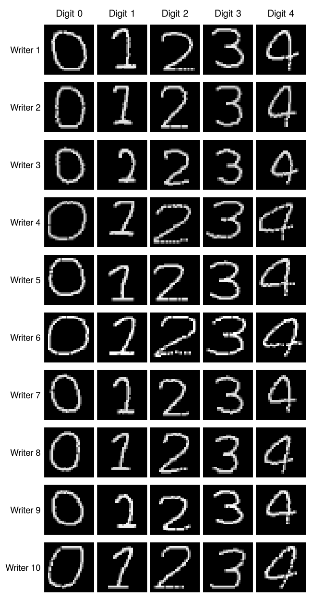
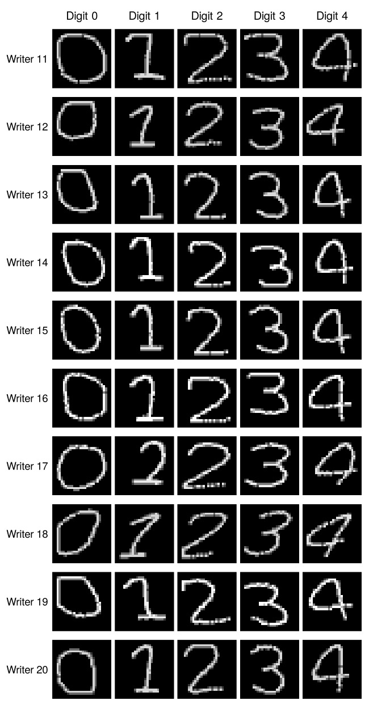

```{r setup, include=FALSE}
knitr::opts_chunk$set(echo = FALSE, message = FALSE, warning = FALSE,
                      fig.align = "center", fig.pos = "H")
library(dplyr)
pct <- function(p, d = 1) sprintf(paste0("%.", d, "f%%"), 100 * p)
and_list <- function(x) {
  x <- as.character(x)
  if (length(x) <= 1) return(x)
  paste(paste(x[-length(x)], collapse = ", "), "and", x[length(x)])
}
dir.create("images", showWarnings = FALSE)
dir.create("results", showWarnings = FALSE)
dir.create("models", showWarnings = FALSE)

need_training <- isTRUE(params$retrain) ||
  !all(file.exists(c("results/cnn_grid.csv", "results/cnn_predictions.csv",
                     "results/siamese_pairs.csv", "results/siamese_design.rds")))
```

```{r data, include=FALSE}
# ---- Task 1: load and check the data; simple image summaries ----
handwriting <- readRDS("data/handwriting.rds")
metadata <- handwriting$metadata
images <- handwriting$images            # 25000 x 28 x 28 x 1, values 0-255

stopifnot(
  dim(images)[1] == nrow(metadata),
  all(metadata$image_id == seq_len(nrow(metadata))),
  all(with(metadata, table(person_id, session, digit)) == 50),
  !anyNA(images), !anyNA(metadata)
)

# Draw one 28 x 28 image the right way up
draw_digit <- function(i) {
  a <- images[i, , , 1]
  image(t(a[28:1, ]), col = gray(seq(0, 1, length.out = 256)),
        zlim = c(0, 255), axes = FALSE, asp = 1, useRaster = TRUE)
}
find_image <- function(person, s, k, r = 1) {
  which(metadata$person_id == person & metadata$session == s &
          metadata$digit == k & metadata$replicate == r)
}
# Grid of images with labels on the outer margins
image_grid <- function(file, index_matrix, row_labels, col_labels,
                       width = 900, height = 900) {
  png(file, width = width, height = height, res = 150)
  par(mfrow = dim(index_matrix), mar = c(0.15, 0.15, 0.15, 0.15),
      oma = c(0.5, 4.5, 2.2, 0.5))
  for (r in seq_len(nrow(index_matrix))) {
    for (cc in seq_len(ncol(index_matrix))) {
      draw_digit(index_matrix[r, cc])
      if (cc == 1) mtext(row_labels[r], side = 2, line = 0.4, las = 1, cex = 0.75)
      if (r == 1) mtext(col_labels[cc], side = 3, line = 0.4, cex = 0.8)
    }
  }
  dev.off()
}
sessions_figure <- function(p) {
  idx <- t(sapply(1:5, function(s) sapply(0:4, function(k) find_image(p, s, k))))
  file <- sprintf("images/sessions_writer_%02d.png", p)
  image_grid(file, idx, paste("Session", 1:5), paste("Digit", 0:4), 650, 650)
  file
}

# (a) all 20 writers x 5 digits, session 1, replicate 1
idx <- t(sapply(1:20, function(p) sapply(0:4, function(k) find_image(p, 1, k))))
image_grid("images/writers_digits.png", idx[1:10, ], paste("Writer", 1:10),
           paste("Digit", 0:4), width = 650, height = 1250)
image_grid("images/writers_digits_b.png", idx[11:20, ], paste("Writer", 11:20),
           paste("Digit", 0:4), width = 650, height = 1250)
# (b) writer 1 across sessions; (c) replicates within one session
sessions_figure(1)
idx <- t(sapply(0:4, function(k) sapply(1:8, function(r) find_image(1, 1, k, r))))
image_grid("images/within_session.png", idx, paste("Digit", 0:4),
           paste("Rep", 1:8), width = 1000, height = 650)

# (d) ink, height and width of every image
summ <- data.frame(
  metadata,
  ink = apply(images[, , , 1], 1, mean),
  height = apply(images[, , , 1], 1, function(a) sum(apply(a > 50, 1, any))),
  width = apply(images[, , , 1], 1, function(a) sum(apply(a > 50, 2, any))))
```

```{r cnn-train, include=FALSE, eval=need_training}
# ---- Tasks 2 and 5: CNN writer identification and grid search ----
library(keras3)
use_backend("tensorflow")
EPOCHS <- 20
BATCH <- 64

x <- images / 255
y <- metadata$person_id - 1            # classes 0, 1, ..., 19

# Split by recording session
train_rows <- which(metadata$session %in% 1:3 & metadata$replicate <= 40)
check_rows <- which(metadata$session %in% 1:3 & metadata$replicate > 40)
val_rows   <- which(metadata$session == 4)
test_rows  <- which(metadata$session == 5)

x_train <- x[train_rows, , , , drop = FALSE]
x_check <- x[check_rows, , , , drop = FALSE]
x_val   <- x[val_rows, , , , drop = FALSE]
x_test  <- x[test_rows, , , , drop = FALSE]
y_train <- to_categorical(y[train_rows], 20)
y_val   <- to_categorical(y[val_rows], 20)
y_test  <- to_categorical(y[test_rows], 20)

write.csv(data.frame(split = c("training", "same-session check", "validation", "test"),
                     images = c(length(train_rows), length(check_rows),
                                length(val_rows), length(test_rows))),
          "results/cnn_split_sizes.csv", row.names = FALSE)

build_cnn <- function(learning_rate, dropout_rate) {
  input <- layer_input(shape = c(28, 28, 1))
  output <- input %>%
    layer_conv_2d(filters = 32, kernel_size = c(3, 3), activation = "relu") %>%
    layer_max_pooling_2d(pool_size = c(2, 2)) %>%
    layer_conv_2d(filters = 64, kernel_size = c(3, 3), activation = "relu") %>%
    layer_max_pooling_2d(pool_size = c(2, 2)) %>%
    layer_flatten() %>%
    layer_dense(units = 128, activation = "relu") %>%
    layer_dropout(rate = dropout_rate) %>%
    layer_dense(units = 20, activation = "softmax")
  model <- keras_model(inputs = input, outputs = output)
  model %>% compile(
    loss = "categorical_crossentropy",
    optimizer = optimizer_adam(learning_rate = learning_rate),
    metrics = c("accuracy")
  )
  model
}
predicted_class <- function(model, x_new) {
  max.col(predict(model, x_new, verbose = 0)) - 1
}

# Grid search: choose the configuration with the best validation accuracy
grid <- expand.grid(learning_rate = c(0.001, 0.0001), dropout_rate = c(0.2, 0.5))
grid$config <- seq_len(nrow(grid))
histories <- list()
grid_results <- list()
for (i in grid$config) {
  set_random_seed(123)
  model <- build_cnn(grid$learning_rate[i], grid$dropout_rate[i])
  history <- model %>% fit(
    x_train, y_train,
    epochs = EPOCHS, batch_size = BATCH, shuffle = TRUE,
    validation_data = list(x_val, y_val),
    verbose = 0
  )
  histories[[i]] <- history$metrics
  grid_results[[i]] <- data.frame(
    config = i,
    learning_rate = grid$learning_rate[i],
    dropout_rate = grid$dropout_rate[i],
    train_accuracy = mean(predicted_class(model, x_train) == y[train_rows]),
    check_accuracy = mean(predicted_class(model, x_check) == y[check_rows]),
    val_accuracy = mean(predicted_class(model, x_val) == y[val_rows]),
    val_loss = tail(history$metrics$val_loss, 1),
    best_val_accuracy_epoch = which.max(history$metrics$val_accuracy),
    lowest_val_loss_epoch = which.min(history$metrics$val_loss)
  )
  save_model(model, sprintf("models/cnn_config_%d.keras", i), overwrite = TRUE)
}
grid_results <- do.call(rbind, grid_results)
write.csv(grid_results, "results/cnn_grid.csv", row.names = FALSE)
saveRDS(histories, "results/cnn_histories.rds")
best <- grid_results$config[which.max(grid_results$val_accuracy)]

# How much does validation accuracy move when only the seed changes?
seed_results <- list()
for (s in c(123, 456, 789)) {
  set_random_seed(s)
  m <- build_cnn(grid$learning_rate[best], grid$dropout_rate[best])
  m %>% fit(x_train, y_train, epochs = EPOCHS, batch_size = BATCH,
            shuffle = TRUE, verbose = 0)
  seed_results[[length(seed_results) + 1]] <- data.frame(
    seed = s, val_accuracy = mean(predicted_class(m, x_val) == y[val_rows]))
}
write.csv(do.call(rbind, seed_results), "results/cnn_seed_check.csv", row.names = FALSE)

# Evaluate the chosen model once on the test session
model <- load_model(sprintf("models/cnn_config_%d.keras", best))
test_eval <- model %>% evaluate(x_test, y_test, verbose = 0)
cnn_predictions <- function(rows, x_new, split) {
  data.frame(image_id = metadata$image_id[rows], split = split,
             actual_writer = metadata$person_id[rows],
             predicted_writer = predicted_class(model, x_new) + 1,
             digit = metadata$digit[rows], session = metadata$session[rows],
             replicate = metadata$replicate[rows])
}
cnn_pred <- rbind(cnn_predictions(check_rows, x_check, "same-session check"),
                  cnn_predictions(val_rows, x_val, "validation"),
                  cnn_predictions(test_rows, x_test, "test"))
cnn_pred$correct <- cnn_pred$actual_writer == cnn_pred$predicted_writer
write.csv(cnn_pred, "results/cnn_predictions.csv", row.names = FALSE)
write.csv(data.frame(selected_config = best, test_loss = test_eval$loss,
                     test_accuracy = test_eval$accuracy),
          "results/cnn_test_evaluate.csv", row.names = FALSE)
```

```{r siamese-train, include=FALSE, eval=need_training}
# ---- Task 3: Siamese network (metric-learning notes) ----
labels <- metadata$person_id

# Split WRITERS before making pairs
set.seed(2026)
writers <- sample(1:20)
train_writers <- sort(writers[1:12])
val_writers   <- sort(writers[13:16])
test_writers  <- sort(writers[17:20])
train_ids <- which(labels %in% train_writers)
val_ids   <- which(labels %in% val_writers)
test_ids  <- which(labels %in% test_writers)

# Partner image has the same writer about half the time
make_pairs <- function(ids, n, class_labels = labels) {
  a <- sample(ids, n, replace = TRUE)
  b <- vapply(a, function(i) {
    same <- runif(1) < .5
    pool <- ids[class_labels[ids] == class_labels[i]]
    if (!same) pool <- ids[class_labels[ids] != class_labels[i]]
    sample(setdiff(pool, i), 1)
  }, integer(1))
  cbind(a, b)
}
make_batch <- function(p, images = x, class_labels = labels) {
  y <- matrix(as.integer(class_labels[p[, 1]] == class_labels[p[, 2]]), ncol = 1)
  list(left = images[p[, 1], , , , drop = FALSE],
       right = images[p[, 2], , , , drop = FALSE], y = y)
}

set.seed(25)
train_pairs <- make_pairs(train_ids, 20000)
val_pairs   <- make_pairs(val_ids, 4000)
test_pairs  <- make_pairs(test_ids, 8000)
train <- make_batch(train_pairs)
valid <- make_batch(val_pairs)
test  <- make_batch(test_pairs)

# Shared encoder: one image -> 32-number embedding
image <- layer_input(shape = c(28, 28, 1))
z <- image |>
  layer_conv_2d(32, 3, activation = "relu") |>
  layer_max_pooling_2d(2) |>
  layer_conv_2d(64, 3, activation = "relu") |>
  layer_global_average_pooling_2d() |>
  layer_dense(32)
set_random_seed(123)
encoder <- keras_model(image, z)

# The same encoder on both images; output = Euclidean distance
a <- layer_input(shape = c(28, 28, 1))
b <- layer_input(shape = c(28, 28, 1))
distance <- list(encoder(a), encoder(b)) |>
  layer_lambda(f = function(z) {
    op_sqrt(op_sum(op_square(z[[1]] - z[[2]]), axis = 2, keepdims = TRUE) + 1e-7)
  })
siamese <- keras_model(list(a, b), distance)

contrastive_loss <- function(y, d) {
  op_mean(y * op_square(d) + (1 - y) * op_square(op_maximum(1 - d, 0)))
}
siamese |> compile(optimizer = optimizer_adam(1e-3), loss = contrastive_loss)
siamese_history <- siamese |> fit(
  list(train$left, train$right), train$y,
  validation_data = list(list(valid$left, valid$right), valid$y),
  epochs = 20, batch_size = BATCH, verbose = 0
)
saveRDS(siamese_history$metrics, "results/siamese_history.rds")
save_model_weights(siamese, "models/siamese.weights.h5", overwrite = TRUE)

# Threshold: best validation balanced accuracy, "same" if distance < threshold
valid_distance <- as.numeric(predict(siamese, list(valid$left, valid$right), verbose = 0))
valid_same <- as.logical(valid$y[, 1])
balanced_accuracy_at <- function(cut, d = valid_distance, same = valid_same) {
  predicts_same <- d < cut
  (mean(predicts_same[same]) + mean(!predicts_same[!same])) / 2
}
threshold_candidates <- sort(unique(valid_distance))
threshold_scores <- vapply(threshold_candidates, balanced_accuracy_at, numeric(1))
threshold <- threshold_candidates[which.max(threshold_scores)]

pair_table <- function(p, batch, d, set) {
  data.frame(set = set, left = p[, 1], right = p[, 2],
             same_writer = batch$y[, 1], distance = d,
             predicted_same = as.integer(d < threshold),
             writer_left = labels[p[, 1]], writer_right = labels[p[, 2]],
             digit_left = metadata$digit[p[, 1]], digit_right = metadata$digit[p[, 2]],
             session_left = metadata$session[p[, 1]],
             session_right = metadata$session[p[, 2]])
}
test_distance <- as.numeric(predict(siamese, list(test$left, test$right), verbose = 0))
siamese_pairs <- rbind(pair_table(val_pairs, valid, valid_distance, "validation"),
                       pair_table(test_pairs, test, test_distance, "test"))
# Extra test sets: one per digit, pairs built only from that digit's images
for (k in 0:4) {
  ids_k <- test_ids[metadata$digit[test_ids] == k]
  p_k <- make_pairs(ids_k, 2000)
  b_k <- make_batch(p_k)
  d_k <- as.numeric(predict(siamese, list(b_k$left, b_k$right), verbose = 0))
  siamese_pairs <- rbind(siamese_pairs, pair_table(p_k, b_k, d_k, paste("digit", k)))
}
write.csv(siamese_pairs, "results/siamese_pairs.csv", row.names = FALSE)
saveRDS(list(train_writers = train_writers, val_writers = val_writers,
             test_writers = test_writers, threshold = threshold,
             val_balanced_accuracy = max(threshold_scores),
             n_train_pairs = nrow(train_pairs), train_same_share = mean(train$y)),
        "results/siamese_design.rds")

# Software versions used for training
tf <- reticulate::import("tensorflow")
writeLines(c(R.version.string,
             paste("keras3", as.character(packageVersion("keras3"))),
             paste("TensorFlow", tf$`__version__`),
             paste("Keras", tf$keras$`__version__`)),
           "results/versions.txt")
writeLines(capture.output(sessionInfo()), "results/session_info.txt")
```

```{r load-results, include=FALSE}
# ---- Read the saved results (written by the two chunks above) ----
grid    <- read.csv("results/cnn_grid.csv")
seeds   <- read.csv("results/cnn_seed_check.csv")
hist    <- readRDS("results/cnn_histories.rds")
cnn     <- read.csv("results/cnn_predictions.csv")
cnn_ev  <- read.csv("results/cnn_test_evaluate.csv")
sizes   <- read.csv("results/cnn_split_sizes.csv")
pairs   <- read.csv("results/siamese_pairs.csv")
design  <- readRDS("results/siamese_design.rds")
s_hist  <- readRDS("results/siamese_history.rds")
versions <- if (file.exists("results/versions.txt")) readLines("results/versions.txt") else
  c(R.version.string, "keras3", "TensorFlow", "Keras")

# CNN summaries
best <- cnn_ev$selected_config
cfg <- grid[grid$config == best, ]
fmt_lr <- function(v) format(v, scientific = FALSE)
test  <- filter(cnn, split == "test")
val   <- filter(cnn, split == "validation")
check <- filter(cnn, split == "same-session check")
acc_test  <- mean(test$correct)
acc_val   <- mean(val$correct)
acc_check <- mean(check$correct)
by_digit_cnn   <- tapply(test$correct, test$digit, mean)
by_writer_test <- tapply(test$correct, test$actual_writer, mean)
by_writer_val  <- tapply(val$correct, val$actual_writer, mean)
always_right <- names(by_writer_test)[by_writer_test == 1]
worst <- sort(by_writer_test)[1:2]
# writers whose accuracy changes most between session 4 and session 5
change <- names(sort(abs(by_writer_val - by_writer_test), decreasing = TRUE))[1:2]

# CNN confusion table for the test session; largest errors with distinct writers
tab <- table(factor(test$actual_writer, 1:20), factor(test$predicted_writer, 1:20))
offd <- tab; diag(offd) <- 0
ord <- order(-offd)
conf <- data.frame(actual = row(offd)[ord], predicted = col(offd)[ord], n = offd[ord])
conf <- conf[!duplicated(conf$actual), ][1:3, ]
# writer pair that is confused most in both directions combined
mutual <- offd + t(offd)
mutual[lower.tri(mutual, diag = TRUE)] <- 0
pair <- which(mutual == max(mutual), arr.ind = TRUE)[1, ]
a1 <- pair[[1]]; b1 <- pair[[2]]
if (tab[b1, a1] > tab[a1, b1]) { tmp <- a1; a1 <- b1; b1 <- tmp }
other <- conf[!(conf$actual %in% c(a1, b1)), ][1, ]
a2 <- other$actual; b2 <- other$predicted
fig_a1 <- sessions_figure(a1)
fig_b1 <- sessions_figure(b1)

# Siamese summaries: accuracy on same pairs, on different pairs, and their average
pair_scores <- function(q) {
  same_acc <- mean(q$predicted_same[q$same_writer == 1] == 1)
  diff_acc <- mean(q$predicted_same[q$same_writer == 0] == 0)
  data.frame(pairs = nrow(q), same_acc = same_acc, diff_acc = diff_acc,
             balanced = (same_acc + diff_acc) / 2,
             accuracy = mean(q$predicted_same == q$same_writer))
}
tp <- filter(pairs, set == "test")
vp <- filter(pairs, set == "validation")
s_test <- pair_scores(tp)
s_val  <- pair_scores(vp)
tp$same_session <- tp$session_left == tp$session_right
tp$same_digit   <- tp$digit_left == tp$digit_right
sd_pos <- mean(tp$same_digit[tp$same_writer == 1])
sd_neg <- mean(tp$same_digit[tp$same_writer == 0])
same_sess  <- mean(tp$predicted_same[tp$same_writer == 1 & tp$same_session])
cross_sess <- mean(tp$predicted_same[tp$same_writer == 1 & !tp$same_session])
s_digit <- do.call(rbind, lapply(0:4, function(k)
  cbind(digit = k, pair_scores(filter(pairs, set == paste("digit", k))))))
# false-match rate for each combination of two different validation writers
vd <- filter(vp, same_writer == 0)
vd$combo <- paste(pmin(vd$writer_left, vd$writer_right),
                  pmax(vd$writer_left, vd$writer_right), sep = " and ")
false_match <- sort(tapply(vd$predicted_same, vd$combo, mean))

# Digit rankings for the two models
sia_bal  <- setNames(s_digit$balanced, 0:4)
cnn_rank <- names(sort(by_digit_cnn, decreasing = TRUE))
sia_rank <- names(sort(sia_bal, decreasing = TRUE))
top_both    <- sort(intersect(cnn_rank[1:3], sia_rank[1:3]))
bottom_both <- sort(intersect(cnn_rank[4:5], sia_rank[4:5]))
rank_gap <- abs(match(as.character(0:4), cnn_rank) - match(as.character(0:4), sia_rank))
disagree <- as.character(0:4)[rank_gap >= 3]
sia_worst <- as.integer(sia_rank[5])

# Grid effects (grid order: lr 0.001/0.0001 within dropout 0.2, then 0.5)
lr_eff <- c(grid$val_accuracy[2] - grid$val_accuracy[1],
            grid$val_accuracy[4] - grid$val_accuracy[3])
dr_eff <- c(grid$val_accuracy[3] - grid$val_accuracy[1],
            grid$val_accuracy[4] - grid$val_accuracy[2])
seed_range <- diff(range(seeds$val_accuracy))
grid_range <- diff(range(grid$val_accuracy))
pts <- function(v) sprintf("%.1f", 100 * v)
```

## 1. Data exploration

The file contains 25,000 grayscale images of the digits 0--4, each 28 by 28 pixels with one channel, and pixel values from 0 to 255. The metadata give `image_id`, `person_id`, `digit`, `session` and `replicate`. There are 20 writers, each with five sessions, and each session contains 50 replicates of every digit, so every writer--session--digit cell has exactly 50 images (1,250 images per writer and 5,000 per digit). There are no missing values and the image IDs match the row order of the image array. The rows are sorted by writer, then digit, then session, then replicate. A recording session is identified by writer *and* session together, because session numbers repeat across writers.

::: {#fig-writers layout-ncol=2}




All 20 writers (rows) and digits 0--4 (columns), session 1, replicate 1.
:::

**Between writers.** @fig-writers holds session and replicate fixed. Writers differ in size, width, slant and in how they build each digit: writer 4 writes wide, slanted forms; writer 3 writes small, compact digits; writer 6's fours are open, while writer 7's are closed. Some writers put a bar at the bottom of the one and some do not.

::: {#fig-sessions layout-ncol=2}


Writer 1 across sessions 1--5 (rows), replicate 1 (left); eight replicates within writer 1, session 1 (right).
:::

**Between sessions and within a session.** Across sessions (@fig-sessions, left), writer 1's style is recognisable but the proportions change: the zero is rounder in some sessions and flatter in others, and the two and four change width. Within one session (@fig-sessions, right), replicates differ only by small shifts in outline, stroke position and brightness.

To put numbers on these sources of variation, we measured three simple features for every image: ink (mean pixel value), height and width (number of rows and columns containing a pixel brighter than 50). @tbl-variation compares how much these features vary between writers, between the sessions of one writer, and between replicates within a session. In each case we computed the standard deviation (SD) separately for each digit and averaged over the digits.

```{r}
#| label: tbl-variation
#| tbl-cap: "Average standard deviation of simple image features at three levels."
sd_parts <- function(v) {
  summ$v <- summ[[v]]
  cell <- summ |> group_by(person_id, digit, session) |>
    summarise(m = mean(v), s = sd(v), .groups = "drop")
  wd <- cell |> group_by(person_id, digit) |>
    summarise(wm = mean(m), ss = sd(m), .groups = "drop")
  dm <- wd |> group_by(digit) |> summarise(bs = sd(wm))
  c(mean(dm$bs), mean(wd$ss), mean(cell$s))
}
vt <- t(sapply(c("ink", "height", "width"), sd_parts))
ratio_hw <- vt[c("height", "width"), 2] / vt[c("height", "width"), 3]
knitr::kable(data.frame(Feature = c("Ink (mean pixel value)", "Height (pixels)", "Width (pixels)"),
                        round(vt, 2)), booktabs = TRUE, row.names = FALSE,
             col.names = c("Feature", "Between writers", "Between sessions (same writer)",
                           "Within a session"))
```

Writer differences are largest, as expected. More importantly, the variation between a writer's sessions is `r sprintf("%.1f", min(ratio_hw))` to `r sprintf("%.1f", max(ratio_hw))` times larger than the variation within a session for height and width. A session therefore shifts all of a writer's images together, so images from the same session are much more alike than images of the same writer from different sessions. This matters for every later split.

**Limitations of the simulated data.** The digits are clean strokes on a black background with no paper texture, ruling, noise or neighbouring characters. Only digits 0--4 and 20 writers are included, and every cell is perfectly balanced. Shapes look like variations on a small number of templates, so real handwriting would be far more diverse. At 28 by 28 pixels, fine stroke detail (pressure, pen lifts) is lost. The session changes are simulated, so we cannot tell which real-world cause (pen, paper, mood) they represent. Results should therefore be read as results about this simulation, not about handwriting in general.

## 2. CNN writer identification

**Prediction task.** Given one digit image, predict which of the 20 writers wrote it. Only pixels are used as input; the digit and session labels are not given to the model. The response is coded 0--19 and one-hot encoded with `to_categorical()`, as in the CNN notes.

**Splits.** Training uses sessions 1--3, replicates 1--40 (`r format(sizes$images[1], big.mark=",")` images). Session 4 is the validation set, used to choose hyperparameters, and session 5 is the test set, used once for the chosen model (`r format(sizes$images[3], big.mark=",")` images each). We also held back replicates 41--50 from sessions 1--3 (`r format(sizes$images[2], big.mark=",")` images). These come from recordings the model has seen, but the images themselves were never used for training. We call them the *same-session check*. Section 4 explains why.

**Model.** The architecture follows the convolution, pooling and MLP structure in the notes. It has a 3-by-3 convolution with 32 filters and ReLU, followed by 2-by-2 max pooling, then a 3-by-3 convolution with 64 filters and ReLU, followed by 2-by-2 max pooling. The result is flattened and passed to a dense layer of 128 ReLU units, then dropout and a 20-unit softmax output. The model is compiled with categorical cross-entropy and the Adam optimiser and trained for a fixed 20 epochs with batch size 64, using session 4 as `validation_data`. The learning rate (`r fmt_lr(cfg$learning_rate)`) and dropout rate (`r cfg$dropout_rate`) were chosen on validation accuracy in Section 5.

```{r}
#| label: fig-cnn-history
#| fig-cap: "Training curves of the chosen CNN: accuracy (left) and cross-entropy loss (right) for the training sessions and the validation session."
#| fig-width: 7.5
#| fig-height: 2.8
h <- hist[[best]]
par(mfrow = c(1, 2), mar = c(4, 4, 1, 1))
plot(h$accuracy, type = "l", lwd = 2, ylim = c(0, 1), xlab = "Epoch", ylab = "Accuracy")
lines(h$val_accuracy, lwd = 2, lty = 2, col = "firebrick")
legend("bottomright", c("training", "validation"), lty = 1:2, lwd = 2,
       col = c("black", "firebrick"), bty = "n", cex = .8)
plot(h$loss, type = "l", lwd = 2, ylim = c(0, max(unlist(h))), xlab = "Epoch", ylab = "Loss")
lines(h$val_loss, lwd = 2, lty = 2, col = "firebrick")
```

Training accuracy keeps rising towards 100% (and is `r pct(cfg$train_accuracy)` when the trained model predicts the training images without dropout). Validation accuracy levels off near `r pct(acc_val, 0)` and validation loss is lowest at epoch `r which.min(h$val_loss)` and rises after that. This is the overfitting pattern from the notes: the model keeps fitting the training sessions but stops improving on a new one.

**Results.** On the test session the model identifies the correct writer for **`r pct(acc_test)`** of images (`r sum(test$correct)` of `r nrow(test)`), compared with 5% for random guessing among 20 writers. Test cross-entropy is `r sprintf("%.2f", cnn_ev$test_loss)`. Validation accuracy was `r pct(acc_val)`, `r if (abs(acc_val - acc_test) < 0.03) "close to the test accuracy, so the choice of model did not flatter the test result" else "so validation and test accuracy differ noticeably; each rests on a single session"`.

```{r}
#| label: tbl-cnn-digit
#| tbl-cap: "CNN writer identification on the test session, by the digit shown."
knitr::kable(data.frame(Digit = 0:4,
                        Images = as.integer(table(test$digit)),
                        Correct = as.integer(tapply(test$correct, test$digit, sum)),
                        Accuracy = pct(by_digit_cnn)),
             booktabs = TRUE)
```

By digit (@tbl-cnn-digit), the `r cnn_rank[1]`s identify their writer most often (`r pct(max(by_digit_cnn))`) and the `r cnn_rank[5]`s least often (`r pct(min(by_digit_cnn))`). These are all predictions from the same model, so the comparison shows how much writer information the model can extract from each digit.

```{r}
#| label: fig-cnn-writer
#| fig-cap: "Left: test accuracy for each writer (dashed line: 5% chance). Right: confusion table of actual against predicted writer for the test session, as row percentages."
#| fig-width: 7.5
#| fig-height: 3.2
par(mfrow = c(1, 2), mar = c(4, 4, 1, 1))
barplot(100 * by_writer_test, names.arg = 1:20, las = 2, cex.names = .7,
        col = "steelblue", ylim = c(0, 100), xlab = "Actual writer", ylab = "Accuracy (%)")
abline(h = 5, lty = 2)
image(1:20, 1:20, t(100 * prop.table(tab, 1))[, 20:1], col = gray(seq(1, 0, length.out = 50)),
      axes = FALSE, xlab = "Predicted writer", ylab = "Actual writer")
axis(1, at = 1:20, labels = 1:20, cex.axis = .6, las = 2)
axis(2, at = 1:20, labels = 20:1, cex.axis = .6, las = 1)
box()
```

Per-writer accuracy varies widely (@fig-cnn-writer). `r if (length(always_right)) paste0("Writer", if (length(always_right) > 1) "s" else "", " ", and_list(always_right), if (length(always_right) > 1) " are" else " is", " always identified") else paste0("Writer ", names(which.max(by_writer_test)), " is identified most often (", pct(max(by_writer_test), 0), ")")`, while writer `r names(worst)[1]` is correctly identified in `r pct(worst[1], 0)` of their test images and writer `r names(worst)[2]` in `r pct(worst[2], 0)`. The confusion table shows where the errors go. The largest are writer `r conf$actual[1]` labelled as writer `r conf$predicted[1]` (`r conf$n[1]` of 250 images), writer `r conf$actual[2]` as writer `r conf$predicted[2]` (`r conf$n[2]`) and writer `r conf$actual[3]` as writer `r conf$predicted[3]` (`r conf$n[3]`). These errors are concentrated, not random. Section 6 shows they are caused by session changes.

**What the measures mean in practice.** Accuracy answers this question: if one of these 20 people writes a single digit on a new occasion, how often does the system name the right person? The answer is `r pct(acc_test, 0)` of the time. The per-writer accuracies and the confusion table matter in practice too, because a system that blames writer `r conf$predicted[1]` for writer `r conf$actual[1]`'s writing makes the same mistake every time, rather than occasionally. The model can only choose among the 20 writers it was trained on; it cannot say "none of these".

## 3. Siamese network for writer matching

The Siamese network follows the metric-learning notes. A shared CNN encoder maps an image to a 32-number embedding: a 3-by-3 convolution (32 filters, ReLU), 2-by-2 max pooling, a 3-by-3 convolution (64 filters, ReLU), global average pooling and a dense layer with 32 outputs. The notes use 16 and 32 filters with a 16-number embedding; we doubled these because telling writers apart is harder than telling digits apart. Both images in a pair pass through the same encoder, so the two branches share weights. A lambda layer returns the Euclidean distance between the two embeddings. The model is trained with the contrastive loss

$$L = yD^2 + (1-y)\max(0, 1 - D)^2,$$

where $y = 1$ for a pair from the same writer and $D$ is the distance. Same-writer pairs are pulled together; different-writer pairs are pushed apart until they are at least the margin (1) apart. We used Adam (learning rate 0.001), batch size 64 and 20 epochs. Triplet loss would be an alternative: it compares an anchor with a positive and a negative image at once. We chose contrastive loss because it works directly with labelled pairs.

**Constructing pairs.** Writers are split *before* any pairs are made: 12 writers for training, 4 for validation (`r and_list(design$val_writers)`) and 4 for testing (`r and_list(design$test_writers)`). Within each group, `make_pairs()` from the notes picks a first image at random and then, with probability one half, a second image by the same writer (otherwise by a different writer in the same group); an image is never paired with itself. This gave `r format(design$n_train_pairs, big.mark=",")` training pairs (`r pct(design$train_same_share)` same-writer), 4,000 validation pairs and 8,000 test pairs. Because partners are drawn from all of a writer's images, pairs naturally mix same and different digits and same and different sessions.

**Should pairs control for digit identity?** If same-writer pairs usually showed the same digit and different-writer pairs did not, the network could learn "same digit" as a shortcut for "same writer". Here the partner is chosen without regard to digit, so in the test set `r pct(sd_pos, 0)` of same-writer pairs and `r pct(sd_neg, 0)` of different-writer pairs show the same digit. Digit agreement therefore tells the network nothing about the label, and the network has to use style. Digit is still controlled at evaluation time: We report same-digit and different-digit pairs separately, and test each digit on its own (Section 6).

In the test set, `r pct(mean(tp$same_session[tp$same_writer == 1]), 0)` of same-writer pairs come from the same session, which allows the session comparison in Section 6. For the digit comparison we also built five extra test sets of 2,000 pairs each, one per digit, using only test-writer images of that digit.

**Threshold and evaluation.** The model outputs a distance, not a decision. As in the notes, we tried every observed validation distance as a threshold and chose the one with the highest balanced accuracy: the average of the accuracy on same-writer pairs and the accuracy on different-writer pairs. The chosen threshold is `r sprintf("%.3f", design$threshold)`; a pair is called "same writer" if its distance is below it. The threshold was then fixed and applied to the test pairs.

```{r}
#| label: fig-siamese-hist
#| fig-cap: "Left: contrastive loss by epoch. Right: test distances for same-writer and different-writer pairs, with the validation-chosen threshold."
#| fig-width: 7.5
#| fig-height: 2.8
par(mfrow = c(1, 2), mar = c(4, 4, 1, 1))
plot(s_hist$loss, type = "l", lwd = 2, ylim = c(0, max(unlist(s_hist))),
     xlab = "Epoch", ylab = "Contrastive loss")
lines(s_hist$val_loss, lwd = 2, lty = 2, col = "firebrick")
legend("topright", c("training", "validation"), lty = 1:2, lwd = 2,
       col = c("black", "firebrick"), bty = "n", cex = .8)
br <- seq(0, max(tp$distance) + .05, by = .05)
top <- max(hist(tp$distance[tp$same_writer == 1], breaks = br, plot = FALSE)$counts,
           hist(tp$distance[tp$same_writer == 0], breaks = br, plot = FALSE)$counts)
hist(tp$distance[tp$same_writer == 0], breaks = br, col = rgb(.8, .2, .2, .5),
     ylim = c(0, top), main = "", xlab = "Distance", ylab = "Pairs", border = NA)
hist(tp$distance[tp$same_writer == 1], breaks = br, col = rgb(.2, .4, .8, .5),
     add = TRUE, border = NA)
abline(v = design$threshold, lwd = 2, lty = 2)
legend("topright", c("same writer", "different writers"), fill = c(rgb(.2, .4, .8, .5),
       rgb(.8, .2, .2, .5)), border = NA, bty = "n", cex = .8)
```

```{r}
#| label: tbl-siamese
#| tbl-cap: "Test pairs (four unseen writers): actual against predicted."
ct <- table(Actual = factor(tp$same_writer, 1:0, c("Same writer", "Different writers")),
            Predicted = factor(tp$predicted_same, 1:0, c("Same", "Different")))
knitr::kable(as.data.frame.matrix(ct), booktabs = TRUE)
```

On the 8,000 test pairs from unseen writers, the network accepts `r pct(s_test$same_acc)` of same-writer pairs and correctly rejects `r pct(s_test$diff_acc)` of different-writer pairs, giving a balanced accuracy of **`r pct(s_test$balanced)`** (chance is 50%). In practice, if the system is asked "did the same person write these two digits?" about two people it has never seen, it confirms a true match `r pct(s_test$same_acc, 0)` of the time and wrongly links two different people `r pct(1 - s_test$diff_acc, 0)` of the time. `r if (s_test$same_acc - s_test$diff_acc > 0.1) "It is therefore much better at confirming genuine matches than at excluding different writers." else if (s_test$diff_acc - s_test$same_acc > 0.1) "It is therefore much better at excluding different writers than at confirming genuine matches." else "The two kinds of error are of similar size."` The two distance distributions in @fig-siamese-hist overlap heavily, which is why no threshold can avoid both kinds of error. On the validation writers the same threshold gave `r pct(s_val$balanced)` balanced accuracy, `r round(100 * abs(s_val$balanced - s_test$balanced))` points `r if (s_val$balanced > s_test$balanced) "higher" else "lower"` than on the test writers. Section 4 explains this gap.

```{r}
#| label: fig-siamese-examples
#| fig-cap: "Example test pairs in each outcome group, with their distances."
#| fig-width: 7.3
#| fig-height: 6
case <- ifelse(tp$same_writer == 1,
               ifelse(tp$predicted_same == 1, "Correct: same", "Incorrect: different"),
               ifelse(tp$predicted_same == 1, "Incorrect: same", "Correct: different"))
case_names <- c("Correct: same", "Correct: different", "Incorrect: different", "Incorrect: same")
set.seed(251)
par(mfrow = c(4, 3), mar = c(.1, .1, 1.6, .1), oma = c(1.5, 0, 0, 0))
for (nm in case_names) {
  available <- which(case == nm)
  chosen <- if (length(available) > 1) sample(available, min(3, length(available))) else available
  for (j in 1:3) {
    plot.new()
    if (j <= length(chosen)) {
      i <- chosen[j]
      plot.window(xlim = c(0, 2), ylim = c(0, 1), asp = 1)
      rasterImage(as.raster(images[tp$left[i], , , 1] / 255), .05, .05, .95, .95)
      rasterImage(as.raster(images[tp$right[i], , , 1] / 255), 1.05, .05, 1.95, .95)
      title(main = sprintf("%s; d = %.2f", nm, tp$distance[i]), cex.main = .8)
    }
  }
}
mtext(sprintf("Same writer if distance < %.2f", design$threshold), side = 1,
      outer = TRUE, line = .3, cex = .8)
```

## 4. Training, validation and test strategy

```{r}
#| label: tbl-splits
#| tbl-cap: "Data splits."
knitr::kable(data.frame(
  Model = c("CNN", "", "", "", "Siamese", "", ""),
  Set = c("Training", "Same-session check", "Validation", "Test",
          "Training", "Validation", "Test"),
  Contents = c("Sessions 1-3, replicates 1-40, all writers",
               "Sessions 1-3, replicates 41-50, all writers",
               "Session 4, all writers", "Session 5, all writers",
               "Pairs from 12 writers", "Pairs from 4 other writers",
               "Pairs from 4 further writers"),
  Purpose = c("Fit weights", "Measure performance on seen recordings",
              "Choose learning rate and dropout", "Final estimate, used once",
              "Fit weights", "Choose the distance threshold", "Final estimate, used once")),
  booktabs = TRUE)
```

The deck-3 notes say to fit on training data, compare settings on validation data and keep the test data separate until the final model is chosen. We followed that rule. The bigger decision is *what* to hold out, because images from the same writer and session are strongly related (@tbl-variation).

**CNN: new sessions of known writers.** A 20-class classifier can only name the writers it was trained on, so every writer must appear in training. What can be held out is the *occasion*. Holding out whole sessions measures the realistic task of recognising a known person's writing on a new day. The same-session check shows what happens otherwise. On held-back replicates from the training sessions, the CNN scores **`r pct(acc_check)`**, against `r pct(acc_test)` on the new session. A random split of images, or Keras' `validation_split`, would therefore have reported about `r pct(acc_check, 0)` accuracy, a figure that does not survive a change of session. Because the rows are sorted by writer, `validation_split = 0.2` would be wrong here for a second reason: it takes the *last* 20% of rows, which would hold out writers 17--20 entirely. We therefore passed an explicit `validation_data` set.

**Siamese: unseen writers.** The Siamese network learns a distance rather than a list of names, so it can be tested on people it has never seen. Writers were split before pairs were built, so no writer or image appears in more than one of training, validation and test. If pairs had been made first and then split at random, the same writers (and even the same images) would appear on both sides and the test would no longer measure matching of new people.

**Leakage and optimism checks.**

- Pixels were divided by the fixed value 255, so no scaling parameters were learned from validation or test data.
- The CNN's hyperparameters and the Siamese threshold were chosen on validation data, and each test set was evaluated once.
- Using one session for validation and one for test means each estimate rests on a single new occasion. Per-writer accuracy changes a lot between the two: writer `r change[1]` scores `r pct(by_writer_val[change[1]], 0)` in session 4 and `r pct(by_writer_test[change[1]], 0)` in session 5, and writer `r change[2]` scores `r pct(by_writer_val[change[2]], 0)` and `r pct(by_writer_test[change[2]], 0)`. Overall accuracy is more stable (`r pct(acc_val)` versus `r pct(acc_test)`).
- The Siamese estimate rests on only four test writers, which give six different-writer combinations. Matching difficulty depends mainly on *which* two writers are compared. Among the validation writers, pairs from writers `r names(false_match)[1]` are wrongly matched only `r pct(false_match[1])` of the time, while pairs from writers `r names(false_match)[length(false_match)]` are wrongly matched `r pct(false_match[length(false_match)], 0)` of the time. A different draw of test writers could move the result by many points, which explains the gap between validation and test. Rotating which writers form the test group would give a more stable estimate.
- The 8,000 test pairs are not 8,000 independent observations: images are reused across pairs and come from only 20 recordings (4 writers by 5 sessions).

## 5. Limited hyperparameter optimisation (CNN)

Following the deck-3 procedure, we trained the CNN for each combination of learning rate (0.001, 0.0001) and dropout rate (0.2, 0.5), with the same seed, architecture, data and 20 epochs, and chose the combination with the highest validation accuracy. To see how much of any difference is just training randomness, we then retrained the chosen configuration with three different seeds.

```{r}
#| label: tbl-grid
#| tbl-cap: !expr paste0("CNN grid search (validation = session 4). Configuration ", best, " has the highest validation accuracy.")
knitr::kable(data.frame(Config = grid$config,
                        `Learning rate` = fmt_lr(grid$learning_rate),
                        Dropout = grid$dropout_rate,
                        `Training acc.` = pct(grid$train_accuracy),
                        `Same-session check` = pct(grid$check_accuracy),
                        `Validation acc.` = pct(grid$val_accuracy),
                        `Validation loss` = sprintf("%.2f", grid$val_loss),
                        check.names = FALSE),
             booktabs = TRUE)
```

```{r}
#| label: fig-grid-curves
#| fig-cap: "Validation accuracy (left) and validation loss (right) by epoch for the four configurations."
#| fig-width: 7.5
#| fig-height: 2.8
cols <- c("grey40", "steelblue", "darkorange", "firebrick")
par(mfrow = c(1, 2), mar = c(4, 4, 1, 1))
plot(NA, xlim = c(1, 20), ylim = c(min(sapply(hist, function(h) min(h$val_accuracy))) - 0.02,
                                   max(sapply(hist, function(h) max(h$val_accuracy))) + 0.02),
     xlab = "Epoch", ylab = "Validation accuracy")
for (i in 1:4) lines(hist[[i]]$val_accuracy, col = cols[i], lwd = 2)
legend("bottomright", paste0("lr ", fmt_lr(grid$learning_rate), ", dropout ", grid$dropout_rate),
       col = cols, lwd = 2, bty = "n", cex = .65)
plot(NA, xlim = c(1, 20), ylim = c(0, max(sapply(hist, function(h) max(h$val_loss)))),
     xlab = "Epoch", ylab = "Validation loss")
for (i in 1:4) lines(hist[[i]]$val_loss, col = cols[i], lwd = 2)
```

```{r}
#| label: tbl-seeds
#| tbl-cap: "Chosen configuration retrained with different seeds."
knitr::kable(data.frame(Seed = seeds$seed, `Validation accuracy` = pct(seeds$val_accuracy),
                        check.names = FALSE),
             booktabs = TRUE)
```

**Sensitivity.**

- **Validation accuracy is not very sensitive.** It ranges from `r pct(min(grid$val_accuracy))` to `r pct(max(grid$val_accuracy))`, a spread of `r pts(grid_range)` percentage points. `r if (all(lr_eff > 0)) paste0("The smaller learning rate is better at both dropout rates (by ", pts(lr_eff[1]), " and ", pts(lr_eff[2]), " points).") else if (all(lr_eff < 0)) paste0("The larger learning rate is better at both dropout rates (by ", pts(-lr_eff[1]), " and ", pts(-lr_eff[2]), " points).") else paste0("The effect of the learning rate changes direction with dropout (", pts(lr_eff[1]), " and ", pts(lr_eff[2]), " points).")` Raising dropout from 0.2 to 0.5 changes validation accuracy by `r pts(dr_eff[1])` and `r pts(dr_eff[2])` points. Changing only the seed moves the chosen configuration's validation accuracy by `r pts(seed_range)` points, `r round(100 * seed_range / grid_range)`% of the grid's spread. `r eff_ok <- c(lr = all(sign(lr_eff) == sign(lr_eff[1])) && min(abs(lr_eff)) > seed_range, dropout = all(sign(dr_eff) == sign(dr_eff[1])) && min(abs(dr_eff)) > seed_range); if (all(eff_ok)) "Both effects are consistent and larger than the seed-to-seed variation." else if (eff_ok["lr"]) "Only the learning-rate effect is consistent and larger than the seed-to-seed variation; the dropout effect cannot be told apart from training noise." else if (eff_ok["dropout"]) "Only the dropout effect is consistent and larger than the seed-to-seed variation; the learning-rate effect cannot be told apart from training noise." else "Neither effect is clearly larger than the seed-to-seed variation, so the grid cannot separate the hyperparameters from training noise."`
- **Validation loss is very sensitive.** At learning rate 0.001 it averages `r sprintf("%.2f", mean(grid$val_loss[grid$learning_rate == 0.001]))`, against `r sprintf("%.2f", mean(grid$val_loss[grid$learning_rate == 0.0001]))` at 0.0001. With the larger learning rate, validation loss is lowest after epoch `r and_list(unique(grid$lowest_val_loss_epoch[grid$learning_rate == 0.001]))` and then climbs, while validation accuracy barely changes (@fig-grid-curves). The model becomes increasingly *confident* about the wrong writer on the new session. The slower learning rate delays this overfitting but does not remove it.
- **Training and same-session accuracy are hardly sensitive at all.** `r if (min(grid$check_accuracy) >= 0.9995) 'Every configuration scores 100% (after rounding) on the same-session check.' else paste0('Every configuration scores at least ', pct(min(grid$check_accuracy)), ' on the same-session check.')` No setting in this grid closes the gap between seen and new sessions, because that gap is not a tuning problem: the training data contain only three recording conditions per writer.

The chosen configuration (learning rate `r fmt_lr(cfg$learning_rate)`, dropout `r cfg$dropout_rate`) scored `r pct(acc_test)` on the test session. Given the seed check, we would expect the other configurations to perform within a few points of it.

## 6. Comparison and discussion

**What each model answers.** The CNN answers "which of these 20 known people wrote this digit?" (chance 5%); the Siamese network answers "were these two digits written by the same person?" for people it has never seen (chance 50%). Their accuracies are not on the same scale and should not be ranked against each other. They are complementary: the CNN needs examples of every writer in advance but names them; the Siamese network needs no enrolment but only compares.

```{r}
#| label: tbl-digits
#| tbl-cap: "Writer information by digit. CNN: test-session identification accuracy. Siamese: extra test sets of 2,000 same-digit pairs per digit from the unseen writers, at the validation-chosen threshold."
knitr::kable(data.frame(Digit = 0:4,
  CNN = pct(by_digit_cnn),
  `Same pairs accepted` = pct(s_digit$same_acc),
  `Different pairs rejected` = pct(s_digit$diff_acc),
  `Siamese balanced acc.` = pct(s_digit$balanced), check.names = FALSE),
  booktabs = TRUE)
```

**Which digits carry more writer information?** Ranked from most to least informative, the CNN orders the digits `r paste(cnn_rank, collapse = ", ")` and the Siamese network orders them `r paste(sia_rank, collapse = ", ")`. `r if (length(top_both)) paste0("Both models place ", if (length(top_both) > 1) "digits " else "digit ", and_list(top_both), " among their three best")` `r if (length(top_both) && length(bottom_both)) "and" else if (length(bottom_both)) "Both models place"` `r if (length(bottom_both)) paste0(if (length(bottom_both) > 1) "digits " else "digit ", and_list(bottom_both), " among their two weakest")``r if (length(top_both) || length(bottom_both)) "."` `r if ("1" %in% bottom_both) "This fits the images: a one is mostly a single vertical stroke with few places for style to show, whereas digits with curves give width, roundness and closure room to vary between writers."` `r if (length(disagree)) paste0("The models disagree most about ", if (length(disagree) > 1) "digits " else "digit ", and_list(disagree), ".")` The Siamese network's weakest digit is `r sia_worst`: it accepts `r pct(s_digit$same_acc[sia_worst + 1], 0)` of same-writer pairs but rejects only `r pct(s_digit$diff_acc[sia_worst + 1], 0)` of different-writer pairs, so the four test writers' `r sia_worst`s sit close together in the embedding. A digit's ranking therefore depends on the model and on which writers are being compared, and only the broad pattern should be taken seriously.

Comparing whole pairs makes the same point. On the main test set, same-writer pairs are accepted `r pct(mean(tp$predicted_same[tp$same_writer==1 & tp$same_digit]))` of the time when both images show the same digit and `r pct(mean(tp$predicted_same[tp$same_writer==1 & !tp$same_digit]))` when they show different digits. `r if (mean(tp$predicted_same[tp$same_writer==1 & tp$same_digit]) > mean(tp$predicted_same[tp$same_writer==1 & !tp$same_digit])) "A shared character makes style easier to compare, but the"  else "The"` network still matches across digits well above chance, so some of what it learns is a general style (size, slant, stroke width) rather than the shape of one digit.

```{r}
#| label: tbl-sessions
#| tbl-cap: "Effect of recording session on performance."
sess <- data.frame(
  Comparison = c("CNN: unseen images from training sessions (1-3)",
                 "CNN: new session 4 (validation)",
                 "CNN: new session 5 (test)",
                 "Siamese: same-writer pairs from the same session",
                 "Siamese: same-writer pairs from different sessions"),
  Images = c(nrow(check), nrow(val), nrow(test),
             sum(tp$same_writer == 1 & tp$same_session),
             sum(tp$same_writer == 1 & !tp$same_session)),
  Correct = pct(c(acc_check, acc_val, acc_test, same_sess, cross_sess)))
names(sess)[2] <- "Images / pairs"
knitr::kable(sess, booktabs = TRUE)
```

**How session changes affect performance.** The session effect is the main finding of this assignment (@tbl-sessions). The CNN identifies writers `r pct(acc_check, 0)` of the time in recordings it has seen, even from images it has never trained on, but only `r pct(acc_test, 0)` of the time in a new session. That gap of `r round(100 * (acc_check - acc_test))` percentage points comes from learning the particular look of each recording rather than the person. The Siamese network shows the same pattern on unseen writers: a true match is accepted `r pct(same_sess)` of the time when both images come from one session but `r pct(cross_sess)` when they come from different sessions.

::: {#fig-writer-pair layout-ncol=2}


Writer `r a1` (left) and writer `r b1` (right) across their five sessions. The CNN labelled `r tab[a1, b1]` of writer `r a1`'s 250 session-5 images as writer `r b1`.
:::

The session change also explains the CNN's worst errors. The model judged writer `r a1`'s session-5 digits to be closer to writer `r b1` than to writer `r a1`'s own training sessions (@fig-writer-pair): `r tab[a1, b1]` of writer `r a1`'s 250 test images were labelled as writer `r b1``r if (tab[b1, a1] >= 25) paste0(', and ', tab[b1, a1], ' of writer ', b1, "'s images were labelled as writer ", a1)`. Writer `r a2`'s session-5 writing was taken for writer `r b2` in `r tab[a2, b2]` of 250 images. Which writers suffer depends on the session: writer `r change[1]` scores `r pct(by_writer_val[change[1]], 0)` in session 4 but `r pct(by_writer_test[change[1]], 0)` in session 5. When a writer's style drifts towards someone else's, the classifier assigns much of that session to the other person.

**What would help.** The notes suggest more varied training data. Here that means more sessions per writer, since three sessions are too few to learn what stays constant about a person, and possibly data augmentation (rotation, cropping) to imitate small changes in size and slant. Larger networks or longer training would not help: the training curves show the model already fits the training sessions almost perfectly.

**Conclusion.** The CNN identifies the writer of a single digit from a new session `r pct(acc_test, 0)` of the time (chance 5%). The Siamese network matches pairs from unseen writers with `r pct(s_test$balanced, 0)` balanced accuracy (chance 50%). `r if (length(top_both)) paste0("Digit", if (length(top_both) > 1) "s " else " ", and_list(top_both), " carr", if (length(top_both) > 1) "y" else "ies", " the most writer information for both models")` `r if (length(top_both) && length(bottom_both)) "and"` `r if (length(bottom_both)) paste0(if (!length(top_both)) "For both models, " else "", "digit", if (length(bottom_both) > 1) "s " else " ", and_list(bottom_both), " the least")``r if (length(top_both) || length(bottom_both)) ", although the exact ranking depends on the model." else "No digit is consistently best or worst across the two models."` Changes between recording sessions are the main obstacle in this data: performance on familiar sessions is far higher than on new ones. Only splits that hold out whole sessions or writers reveal this.


## Appendix A: code

All results in this report come from the code below, which runs when the document is rendered. Methods follow the course notes (the CNN notes, slide decks 1--3 and the metric-learning notes).

```{r show-code, ref.label=c("data", "cnn-train", "siamese-train"), echo=TRUE, eval=FALSE}
#| code-fold: true
#| code-summary: "Show the full analysis code"
```

## Appendix B: software

Models were trained with `r versions[1]`, `r versions[2]`, `r versions[3]` and `r versions[4]` (Python backend). The full R session information is saved in `results/session_info.txt`.

## AI use statement

*Edit this so that it describes exactly how your group used AI tools.*

We used Claude (an AI assistant made by Anthropic) during this project. It was used to review our earlier report against the course notes; to rewrite the analysis code so that it uses only methods covered in the notes; to train the models and check the results; and to draft and revise the text of this report. The data splits, the models and every number reported here come from the code in Appendix A, which we ran and checked ourselves. We reviewed all AI-generated code and text, and we take responsibility for the content of this report.
